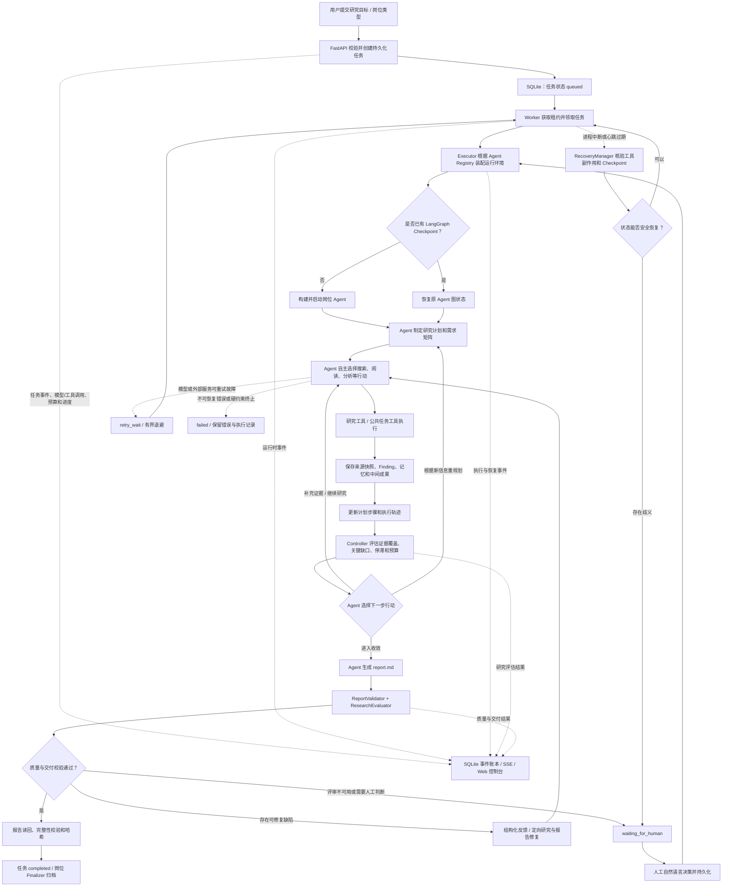

# 研究数字员工设计说明

本文围绕开发测试题的四个设计问题，说明本项目对数字员工的理解、系统模块划分、关键技术问题和后续演进方向。以下分析以当前仓库的实际实现为依据，并区分岗位 Agent 的自主决策与公共 Runtime 的确定性控制。

## 一、如何理解“数字员工”与普通 LLM 应用的区别

### 1. 普通 LLM 应用与数字员工的基本定位不同

普通 LLM 应用通常以**一次请求或一轮对话**为基本交互单位：用户提出问题，应用将输入组织为 Prompt，调用大语言模型生成回答，再将结果返回给用户。应用可以附加检索、函数调用、对话历史或工作流，但它的主要职责通常仍然是响应当前请求。即使某次回答需要多次模型调用或工具调用，任务也往往围绕当前请求执行，响应返回后，本次交互便告一段落。

数字员工则以**用户委托的任务及其最终交付结果**为基本工作单位。用户给出的不只是一个等待回答的问题，而是一个需要完成的目标，例如调研一组技术方案、比较其差异、形成有依据的研究报告。数字员工需要理解目标和交付要求，自主组织工作，持续调用外部能力，判断当前结果是否足以支撑目标，并对任务从启动到交付的整个过程负责。

二者的差异并不取决于是否使用了同一个大语言模型，也不取决于是否接入了搜索工具。普通 LLM 应用同样可以具备工具调用和多轮对话能力；数字员工的关键在于，系统是否围绕长期任务建立了完整的执行、状态管理、质量控制和异常处理机制。

### 2. 数字员工区别于普通 LLM 应用的核心特征

| 比较维度 | 普通 LLM 应用的典型形态 | 数字员工需要具备的能力 |
|---|---|---|
| 工作目标 | 主要响应当前问题或对话轮次 | 面向明确的任务目标和交付物，持续推进直至完成或进入可解释的终止状态 |
| 工作组织 | 由用户逐轮提出要求，或由应用预先定义固定流程 | 能够将目标拆解为计划，自主选择下一步行动，并根据新信息调整计划 |
| 决策方式 | 主要根据当前输入生成回答，工具调用通常受既定流程约束 | 能够结合任务状态、工具反馈、已有证据和剩余资源作出连续决策 |
| 外部行动 | 重点是生成文本；工具通常作为回答过程的辅助 | 能够检索、读取和分析外部资料，保存研究资料与中间成果，实际推进任务并形成可交付成果 |
| 状态与记忆 | 主要依赖当前上下文或对话历史 | 需要持久化任务状态、执行进度、计划版本、中间成果和研究记忆，不能依赖单次上下文存活 |
| 长时运行 | 请求结束或服务中断后，通常需要重新发起交互 | 能够跨请求、跨上下文压缩和进程重启持续工作，并在恢复时识别已完成的工作 |
| 异常处理 | 常见方式是返回错误、重试请求或等待用户重新提问 | 能够区分可重试故障、终态错误和状态不确定的情况，核验执行副作用后安全恢复，必要时请求人工决策 |
| 结果验收 | 主要检查回答是否相关、流畅或符合格式 | 需要验证交付物是否存在、结构是否正确、结论是否有证据支持、质量是否达到任务要求 |
| 过程责任 | 主要展示模型回答或有限的调用日志 | 能够记录计划变化、模型与工具调用、证据来源、错误、重试、预算和恢复决策，支持复盘与审计 |
| 岗位扩展 | 常按单一应用场景组织 Prompt、工具和业务逻辑 | 将岗位专属知识、Agent 和工具与公共任务运行能力分离，使不同岗位能够复用基础设施 |

因此，数字员工不是“给 LLM 增加几个工具”，也不等同于“把多个 Agent 组合起来”。它本质上是一个以任务为中心的自治执行系统：**Agent 负责理解目标、研究分析和选择行动；公共运行时负责让任务能够长期执行、保存、恢复和受控；证据与质量机制负责判断过程是否充分、结果能否交付。**

### 3. 当前项目如何通过模块设计满足数字员工的专属需求

本项目以研究岗位为切入点，将数字员工的能力落实到岗位 Agent、公共任务运行时、持久化与证据管理、研究控制和质量验收等模块中。

| 数字员工的专属需求 | 项目中的模块设计 | 当前实现及其作用 |
|---|---|---|
| 面向任务目标持续工作，而不是只响应一次请求 | FastAPI 任务接口 + Worker + Executor | API 创建持久化任务并返回任务标识；独立 Worker 在后台领取和执行任务，研究过程不依赖浏览器或单次 HTTP 请求持续存活 |
| 自主拆解任务并动态调整研究路径 | Research Agent + 研究计划工具 | Research Agent 基于 Deep Agents 和 LangGraph 构建，使用岗位 Profile/Prompt 和工具完成规划与研究；通过 update_research_plan 创建初始计划或记录实质性重规划，流程不是由程序写死的搜索—阅读—写作流水线 |
| 能够真正调用外部能力并保存工作成果 | ResearchToolService + ArtifactStore | 提供 Tavily 网页搜索、网页与 PDF 读取、GitHub MCP、arXiv 等研究工具，并提供任务级 Artifact 和研究记忆读写能力 |
| 研究结论有依据、研究范围可检查 | EvidenceRegistry + ResearchController | 来源读取后保存快照并分配来源 ID；Finding 记录结论、来源 ID 和研究维度；Controller 根据有效来源和 Finding 计算维度覆盖率，识别关键缺口与停滞 |
| 能够跨长时间和进程中断保留工作状态 | Database + LangGraph Checkpoint + 任务工作区 | SQLite 保存任务状态、事件、预算和控制记录；LangGraph Checkpoint 保存图执行状态；任务工作区保存计划、研究记忆、来源快照和报告，三者分别承担业务状态、Agent 上下文和研究产物的持久化 |
| 能根据研究结果决定后续工作，而不是机械执行原计划 | ResearchLifecycleCoordinator + ResearchController | 在研究阶段边界和最终交付阶段检查研究覆盖、质量与预算状态，向 Agent 返回补充证据、重规划、继续研究、收敛或请求人工等建议；Agent 结合实际证据选择研究行动，运行时负责执行预算和人工停车等硬约束 |
| 能够处理模型、工具和进程故障 | Worker + RecoveryManager + TaskEventCallback | Worker 使用租约、心跳和执行代次管理任务所有权；工具调用进入持久化生命周期台账；进程失联后先核验未知调用的副作用和 Checkpoint，再决定安全重试、恢复或转人工，而不是盲目从头执行 |
| 交付结果可验证、质量不达标时能够继续处理 | ReportValidator + ResearchEvaluator + 岗位修复器 | 对报告结构、来源 ID、URL 和引用覆盖进行确定性校验；再从目标覆盖、证据充分性、来源可靠性、结论一致性和报告完整性等维度评估质量；缺陷反馈给 Agent 定向修复，必要时进入人工决策 |
| 开发者能够理解和复盘任务执行过程 | 事件账本 + 模型/工具调用记录 + SSE + 计划进度接口 | 持久化记录任务状态变化、模型和工具调用、计划步骤、质量评估、预算及恢复决策；前端通过事件流展示执行过程，并支持按事件游标续传 |
| 未来不同岗位能够复用公共能力 | Agent Registry + 公共 Runtime | AgentRegistration 将岗位 Builder、Profile、产物路径、Validator、Postprocessor、Finalizer 和预算默认值抽象为注册契约；Worker、Executor、任务持久化、Checkpoint 和预算机制由公共运行时提供 |

这套设计将数字员工的“智能决策”和“工程可靠性”分开处理。Research Agent 不需要通过 Prompt 自行保证任务状态一致、预算不超限或进程中断后不重复写入；这些责任由数据库、Worker、Executor、预算控制和 RecoveryManager 承担。反过来，公共运行时也不替 Agent 预先规定每一步应该搜索什么、阅读什么或得出什么结论，研究路径仍由 Agent 根据任务和证据决定。

项目当前生产环境默认注册 Research Agent，并采用单机单 Worker、单 Agent 的最小运行方式；当前 Agent 构建配置未启用子 Agent，也未向模型开放 Shell 执行工具。Agent Registry 的岗位注册契约已通过测试中的第二岗位验证其公共运行时复用能力。这体现了本项目的设计取舍：数字员工的关键不在于堆叠 Agent 数量，而在于先验证长期任务自治、证据反馈、状态恢复和质量交付的核心闭环，再根据真实任务规模扩展岗位数量和并发执行能力。

设计是否有效还需要通过执行测试验证，而不是仅凭模块名称判断。当前 tests/test_autonomous_research_e2e.py 使用条件模型读取真实工具返回的测试证据：矛盾证据触发计划重规划，支持性证据则保留原计划；tests/test_process_crash_recovery.py 和 tests/test_worker_fencing_races.py 分别验证进程中断后的副作用核验与 Worker 执行代次隔离。这些测试验证了关键控制逻辑和持久化机制，真实模型与外部服务的研究效果仍需在实际部署中持续观察。

## 二、系统的核心模块如何划分，以及为什么

### 1. 系统完整的核心运行流程

系统以任务为中心组织运行。用户提交研究目标后，API 先将任务写入数据库；独立 Worker 领取任务并交给 Executor；Executor 根据岗位注册信息构建对应 Agent，并连接任务专属的 Checkpoint、工作区和运行时回调。Agent 随后自主规划和执行研究，通过工具获取资料、保存来源与中间成果，并根据新证据决定是否补充研究或调整计划。研究达到收敛条件后，Agent 生成报告，系统执行结构校验和质量评估；通过后完成交付，未通过则进行有限修复或进入人工决策。任务运行期间发生异常时，系统根据故障类型和已持久化状态进行重试或恢复。

具体流程如下：

1. **任务提交与持久化。** 用户在 Web 控制台提交研究目标和岗位类型。FastAPI 校验岗位是否已注册，读取岗位预算默认值，在 SQLite 中创建 queued 任务，并初始化任务工作区。
2. **Worker 领取任务。** 后台 Worker 获取全局租约，通过数据库领取待执行任务，递增 worker_generation 并定期更新 Worker 租约和任务心跳。任务执行与 API 请求、浏览器会话相互独立。
3. **Executor 装配或恢复 Agent。** Executor 根据任务的 agent_type 查询 Agent Registry，取得岗位 Builder、Profile、产物路径、校验器、修复器和预算配置；随后打开 LangGraph Checkpoint。如果任务已有 Checkpoint，则恢复原图状态；否则启动新的 Agent 执行。
4. **Agent 自主规划与研究。** Research Agent 理解用户目标，制定研究计划和研究需求矩阵，随后自主选择搜索、网页/PDF 阅读、GitHub 仓库分析、arXiv 论文检索等工具。Agent 不需要按照固定的工具调用顺序执行，而是根据当前上下文和工具返回结果选择后续行动。
5. **证据登记与计划进度更新。** 读取到的资料被保存为任务级来源快照；Agent 将重要结论登记为 Finding，并关联来源 ID 和研究维度。PlanProgressTracker 将 Agent 的步骤状态和运行时检测到的工具活动关联起来，记录步骤进度、工具调用和预期产物核验情况。
6. **研究控制与动态调整。** ResearchLifecycleCoordinator 在研究阶段边界协调 ResearchController 评估证据覆盖；在最终交付阶段进一步协调 ResearchEvaluator 执行质量评估。Controller 根据研究维度、Finding、有效来源、关键缺口、停滞情况和预算阶段生成行动建议；Agent 根据证据决定继续研究、补充缺口或提交完整的新计划。进入收敛阶段后，运行时限制新的探索性搜索和资料读取，为报告综合与交付保留资源。
7. **报告生成与质量验收。** Agent 将研究成果写入岗位声明的产物路径。ReportValidator 检查 Markdown 结构、来源 ID、直接 URL 和结论段落的引用覆盖；ResearchEvaluator 结合规则评分和独立上下文评审，检查目标覆盖、证据充分性、来源可靠性、结论一致性和报告完整性。
8. **交付、修复或人工决策。** 如果报告通过校验，Executor 重新读取报告，验证非空并计算 SHA-256，记录交付事件；Worker 将任务标记为完成，并调用岗位 Finalizer 归档计划和执行结果。如果质量未通过且缺陷可修复，则将结构化反馈交给 Agent 定向修复，再次验证；评审不可用、修复后仍未达到门槛且允许人工处理，或恢复状态存在歧义时，任务进入 waiting_for_human，由操作人员通过自然语言指令决定继续研究、调整方向、继续修复、批准降级交付或终止任务；触发不可豁免硬性阻断且无法修复的情况则按失败路径处理。
9. **异常重试与断点恢复。** 模型或外部服务异常由运行时分类；可重试错误进入 retry_wait 并按有界指数退避重新调度，终态错误则记录失败。若 Worker 心跳过期，RecoveryManager 先检查未完成工具调用，将状态不确定的调用标记为 unknown，再根据工具类型核验 Artifact、Finding、计划等副作用，并检查 Checkpoint。只有能够安全确认的任务才重新入队；存在歧义时转人工处理。
10. **全过程记录与观察。** 任务事件、模型调用、工具调用、计划版本、步骤进度、证据、预算、质量评估和恢复决策持续写入数据库或任务工作区。前端通过 API 查询详情，并通过 SSE 实时接收事件；断线后可利用事件 ID 续传，开发者能够还原任务执行过程。

### 2. 核心模块及职责

本项目按**职责边界和变化原因**划分模块，而不是简单地按技术框架或代码目录拆分。岗位研究策略会随岗位变化，任务调度、状态持久化和故障恢复则是不同岗位都需要的基础能力；因此，系统将岗位 Agent 与公共 Runtime 分离，同时将研究证据、研究控制、持久化和交付验收组织为相互协作的独立职责模块。这里的模块是逻辑职责划分，不意味着每个模块都需要独立部署为微服务。

#### （1）任务接入与操作接口模块

**主要实现：** app/api/main.py、app/api/routes.py、app/static/。

**核心职责：**
- 接收用户的研究目标和岗位类型，校验岗位注册情况并创建任务。
- 提供任务查询、暂停、恢复、重试、取消、预算扩展和人工干预接口。
- 提供计划、步骤进度、事件、证据、研究状态、预算和 Artifact 查询接口。
- 通过 SSE 向前端推送执行事件，并支持根据事件 ID 续传。

**划分理由：** 接入层负责人与系统之间的交互，不应直接承担几十分钟的 Agent 执行。将任务创建和操作接口与后台执行解耦，可以避免 HTTP 请求超时或浏览器关闭影响任务运行，也让前端能够通过统一接口观察和控制不同岗位的任务。

#### （2）岗位 Agent 与注册模块

**主要实现：** app/agents/registry.py、app/agents/research/agent.py、app/agents/research/profile.toml、app/agents/research/system_prompt.md。

**核心职责：**
- Agent Registry 通过 AgentRegistration 定义岗位 Builder、Profile Loader、输出产物路径、Validator、Postprocessor、Finalizer 和预算默认值。
- Research Agent 负责理解研究目标、制定和调整计划、选择工具、分析资料、登记发现、维护研究记忆并撰写报告。
- 岗位 Profile 和 System Prompt 描述该岗位的工作目标、工具使用规范和交付要求。
- Executor 根据任务的 agent_type 调用相应 Builder，避免在公共运行时中写死某一岗位的 Agent 构建逻辑。

**划分理由：** 研究岗位与未来的数据分析、代码开发或其他岗位，在知识、工具、计划策略和产物格式上会有明显差异；但它们不应各自重复实现任务状态机、Worker、Checkpoint 和恢复机制。将岗位能力注册化，可以在保留岗位自主性的同时复用公共基础设施。当前生产环境默认注册 Research Agent，第二岗位通过测试验证了公共运行时复用能力。

#### （3）外部工具与证据管理模块

**主要实现：** app/tools/research_tools.py、app/infrastructure/evidence_registry.py、任务级 ArtifactStore。

**核心职责：**
- 提供网页搜索、网页读取、PDF 下载与文本提取、GitHub 仓库/源码只读访问和 arXiv 检索等外部研究能力。
- 提供中间成果、研究计划、研究记忆和报告的任务级读写能力。
- 将读取成功的资料保存为来源快照，记录来源 ID、URL、标题、类型、获取信息和内容哈希。
- 将研究结论登记为 Finding，并关联来源 ID 与研究维度，为后续覆盖评估和报告引用提供结构化依据。

**划分理由：** Agent 负责决定“需要什么资料、如何使用资料”，工具服务负责“如何安全、规范地执行外部操作”，证据登记簿负责“资料和结论如何持久化、如何追溯”。将三者分开，既能替换或增加外部工具，也能避免研究结论只存在于模型对话中，无法核验来源。

#### （4）公共任务执行与控制模块

**主要实现：** app/runtime/worker.py、app/runtime/executor.py、TaskEventCallback、app/runtime/budget.py 及相关错误处理组件。

**核心职责：**
- Worker 负责获取全局租约、领取任务、更新心跳、调度重试和发现失联任务。
- Executor 负责根据岗位注册信息构建 Agent，连接 Checkpoint，执行或恢复图状态，并在结束时执行产物校验和岗位收尾。
- TaskEventCallback 记录模型与工具调用生命周期，执行任务暂停/取消检查、Token 和运行时间检查，并关联计划步骤进度。
- 预算控制在模型调用和工具执行前检查资源，限制工具调用次数、Token 和累计运行时间，并为收敛与交付保留资源。
- 错误分类组件区分可重试故障和终态错误，配合有界退避策略处理暂时性故障。

**划分理由：** 长任务的运行可靠性不能依靠 Agent Prompt 自行保证。Worker、Executor 和回调机制属于所有岗位都需要的公共运行能力，应独立于具体研究策略。这样，即使更换岗位 Agent，也可以继续复用相同的任务调度、预算控制、状态管理和异常处理机制。

#### （5）计划进度与研究控制模块

**主要实现：** app/runtime/plan_progress.py、app/runtime/research_controller.py、app/runtime/lifecycle_coordinator.py。

**核心职责：**
- PlanProgressTracker 管理计划版本和步骤状态，将工具调用与当前步骤关联，并在预期产物存在且通过读回核验后确认步骤完成。
- ResearchController 根据研究需求矩阵、Finding 和有效来源计算维度覆盖率，识别关键缺口和研究停滞，并生成受限的行动建议。
- ResearchLifecycleCoordinator 在研究阶段边界协调证据覆盖评估，并在最终交付阶段进一步调用 ResearchEvaluator 完成质量评估。
- Agent 根据控制器提供的状态和建议自主决定是否补充证据、继续研究或提交战略重规划；运行时负责执行预算和人工停车等硬约束。

**划分理由：** 仅让 Agent 在 Prompt 中承诺“充分研究”无法证明研究范围已覆盖，也无法稳定识别研究停滞。将计划进度追踪和证据覆盖评估从 Agent 的自由生成中分离，可以获得可持久化、可解释的进度事实；同时，Controller 只提供建议而不替 Agent 搜索或改写计划，保留研究决策的自主性。

#### （6）持久化与异常恢复模块

**主要实现：** app/infrastructure/database.py、LangGraph SQLite Checkpoint、任务级 ArtifactStore、app/runtime/recovery_manager.py。

**核心职责：**
- SQLite 任务数据库保存任务状态、Worker 所有权和执行代次、预算、事件、工具调用、研究控制、质量评估、恢复决策和人工干预记录。
- LangGraph Checkpoint 保存 Agent 的图执行状态和消息上下文，以任务 ID 作为 thread_id。
- ArtifactStore 保存任务计划、研究记忆、来源快照、中间成果和最终报告。
- RecoveryManager 在 Worker 心跳过期后核验未完成工具调用，将不确定调用标记为 unknown，根据工具类别检查已产生的持久化副作用，并检查 Checkpoint 是否可用。
- 对可确认的写操作保留已完成结果，对只读请求按预算允许重试；无法确认的副作用不盲目重放，而是转入人工处理。

**划分理由：** 任务业务状态、Agent 图执行上下文和研究文件是三种不同的数据，不能依赖单一数据库或对话历史替代。将它们分开保存，可以分别满足任务调度、断点恢复和研究成果管理的需要；恢复模块负责协调这些存储之间的状态一致性，而不是假设跨数据库和文件系统存在原子事务。

#### （7）质量评估与交付模块

**主要实现：** app/runtime/report_validator.py、app/runtime/research_evaluator.py、岗位注册的 Validator/Postprocessor/Finalizer。

**核心职责：**
- ReportValidator 对报告标题、来源章节、正文长度、来源 ID、直接 URL、来源快照和结论段落引用覆盖进行确定性检查。
- ResearchEvaluator 结合规则评分与独立上下文 LLM 评审，从目标覆盖度、证据充分性、来源可靠性、结论一致性和报告完整性五个维度评估报告。
- Executor 根据评估缺陷调用岗位 Postprocessor，执行有限轮次的定向研究或报告修复。
- 报告通过后重新读取产物并记录哈希；未达到交付门槛或评审不可用时，根据情况进入人工决策或失败处理。

**划分理由：** 生成报告的 Agent 不应同时成为唯一的质量裁判。将结构校验和质量评估放在独立交付环节，可以减少“模型生成了报告就视为任务完成”的问题；岗位通过注册自己的校验器和修复器，又能适配不同岗位的交付标准。

#### （8）可观测性与人工协同模块

**主要实现：** app/infrastructure/database.py 中的事件与人工决策记录、TaskEventCallback、SSE 接口及 Web 控制台。

**核心职责：**
- 将任务状态变化、模型调用、工具调用、计划调整、预算告警、质量评估和恢复决策写入事件账本。
- 为模型和工具调用记录状态、耗时、输入/输出摘要、Token 使用和错误信息。
- 将计划版本、步骤状态、当前步骤与工具调用关联，帮助开发者理解任务执行到了哪里。
- 在研究停滞、评审不可用、质量未收敛或恢复存在歧义时创建人工待办。
- 接收操作人员的自然语言指令并持久化；任务恢复时将人工意见注入 Agent 上下文，由 Agent 结合当前证据和任务状态执行。

**划分理由：** 数字员工不仅要完成任务，还必须让开发者知道任务如何完成、为什么调整方向、在哪里失败以及恢复时做出了什么判断。将可观测性和人工协同作为贯穿执行过程的能力，可以使自动执行保持可检查、可干预，而不是形成不可解释的黑盒。

### 3. 模块划分的总体原则

上述模块并非相互孤立，而是围绕任务生命周期协同工作。整体划分遵循以下原则：

1. **岗位能力与公共能力分离。** Agent、岗位 Prompt、研究工具策略和交付标准属于岗位；任务调度、状态持久化、预算、Checkpoint、事件记录和恢复机制属于公共 Runtime。
2. **自主决策与确定性控制分离。** Agent 决定研究什么、如何分析以及何时需要重规划；运行时负责预算硬限制、任务状态转换、工具调用审计和安全恢复。
3. **执行上下文与业务事实分离。** Checkpoint 保存图执行状态，任务数据库保存任务和审计事实，工作区保存研究资料与交付物。
4. **成果生成与质量验收分离。** Agent 负责生成研究成果，独立的校验和评估模块检查结构、证据和质量，必要时再将缺陷反馈给 Agent。
5. **自动执行与人工控制衔接。** 对系统能够可靠判断的情况自动处理；对证据不足、质量未收敛或副作用不确定的情况保留人工决策入口。

当前采用 Deep Agents + LangGraph、FastAPI、SQLite 和单 Worker，优先验证长期任务自治、证据驱动调整、断点恢复和可信交付的完整链路，而不是提前引入消息队列、分布式调度或多 Agent 协作。这样的模块边界既满足当前最小版本的可运行要求，也为后续增加不同岗位、并发 Worker 和更复杂的运行基础设施保留了扩展空间。

## 三、当前方案最重要的三个技术问题

### 1. 长任务中的状态一致性与安全恢复

任务数据库、LangGraph Checkpoint 和任务工作区保存的是不同事实；工具还可能已经产生副作用，但进程在结果写回前中断。简单地重新运行 Agent 可能重复写入成果或错误地推进任务。

当前通过 Worker 租约、`worker_generation`、工具调用生命周期台账、幂等键、Checkpoint 检查和按工具类型核验来处理恢复。只读请求可以按预算重新执行；已知写操作需要从 Artifact、Finding、计划或进度记录中确认副作用；无法证明状态唯一正确时转人工处理。核心不是“让进程重新启动”，而是判断上一次执行实际完成了什么。

### 2. 自主研究中的证据驱动控制

仅通过 Prompt 要求 Agent “充分研究”无法判断它是否覆盖了用户真正关心的问题。搜索结果数量也不能代表研究充分性。

当前通过结构化研究计划和研究需求矩阵明确研究范围，以 Finding—Source 关联记录结论依据，再由 Research Controller 计算维度覆盖率、识别关键缺口和停滞状态。Controller 给出受限行动建议，Agent 根据新证据决定补充研究或进行战略重规划。这样既保留了 Agent 对研究路径的自主性，也使研究进展能够被系统检查。

### 3. 资源约束、交付质量与过程可诊断性

长时间搜索、阅读和模型调用会持续消耗 Token、工具调用次数和运行时间；外部服务也可能超时或返回不稳定结果。如果只在任务开始时检查预算，无法保证最终报告有资源完成。

当前在模型调用前预留 Token，在工具开始前消耗工具预算，并在执行边界检查累计运行时间；探索额度触及收敛边界后，系统限制新的搜索和资料读取，为综合、保存、验证和修复保留资源。报告交付还需经过结构与引用校验、五维质量评估和有限修复。所有关键执行动作、错误、重试和恢复决策进入事件账本，支持事后分析。

## 四、如果系统运行半年并积累大量成功和失败任务，最值得做的三项改进

### 1. 建立可回放的任务评测与失败分析体系

将任务目标、计划版本、来源、Finding、工具调用、质量分数、修复轮次和最终结果整理为脱敏评测样本，建立代表性研究任务集和故障注入集。通过版本回放比较不同模型、Prompt、工具和控制策略对任务完成率、证据质量、资源消耗和人工介入率的影响。优先建立可重复的评估基准，而不是直接把历史日志用于训练。

### 2. 根据任务规模演进公共运行基础设施

当任务量和岗位数量增长后，将当前单机 SQLite 与单 Worker 运行方式演进为支持并发的数据库、持久化队列和 Worker 池，并补充租户隔离、分布式租约和统一产物存储。同时继续完善工具幂等契约、外部副作用核验和故障恢复演练，使不同岗位能够共享可靠运行时。

### 3. 利用历史结果优化研究策略与岗位能力

分析不同任务类型下的来源质量、工具成功率、模型表现、预算消耗和修复收益，逐步优化模型/工具路由、来源优先级、预算分配、重试策略和研究模板。将经过验证的执行经验沉淀为岗位 Profile 和可复用工具契约，让新岗位复用公共运行时，而不复制整套 Agent 执行系统。

---

**设计结论：** 本项目将“自主研究”交给岗位 Agent，将“长期任务可靠运行”交给公共 Runtime，将“研究是否充分、成果是否可交付”交给证据控制和质量门禁。最小版本优先验证这三者之间的协作关系，再根据真实任务记录扩展并发调度和岗位数量。
