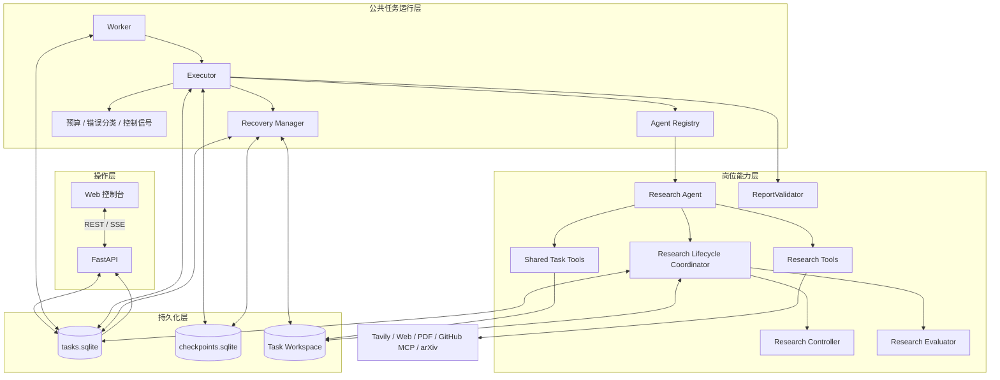
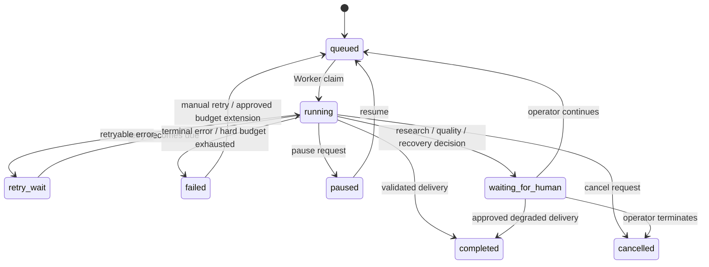

# 系统架构与关键技术取舍

## 一、设计目标与约束

本项目面向长时运行的研究任务：用户给出研究目标和交付要求，Agent 自主检索、阅读、分析资料，并根据新证据调整后续工作，最终形成有依据的 Markdown 报告。

架构设计围绕四个目标展开：

1. **自治性**：研究路径由 Agent 根据任务和证据决定，而不是由程序预先写死。
2. **持久性**：任务、执行上下文、证据和中间成果能够跨请求、跨进程保存。
3. **可诊断性**：关键模型调用、工具调用、计划变化、错误和恢复决策能够追溯。
4. **可扩展性**：岗位差异留在岗位层，任务运行和可靠性能力沉淀为公共服务。

最小版本选择单机、SQLite、单 Worker，减少分布式系统带来的额外变量，优先验证长期任务状态、证据控制和恢复机制。

## 二、总体架构

## 三、模块边界与职责

### 3.1 操作接口层

FastAPI 负责接收任务和人工操作请求，提供任务、岗位、事件、计划、研究状态、证据、记忆、预算和成果查询。Web 控制台展示执行过程并通过 SSE 接收事件。

API 不承担长时间研究执行。任务创建后由独立 Worker 领取，避免将几十分钟的任务绑定到单次 HTTP 请求或浏览器会话。

### 3.2 公共运行时

| 组件 | 当前职责 |
|---|---|
| Worker | 获取全局租约、心跳、领取任务、过期任务检查、重试调度 |
| Executor | 构建岗位 Agent、绑定 Checkpoint 和回调、管理模型/工具调用、预算控制、成果验证和修复 |
| Agent Registry | 通过 `AgentRegistration` 描述 Builder、Profile Loader、产物路径、Validator、Postprocessor、Finalizer 和预算默认值 |
| Recovery Manager | 标记未知工具调用、核验已发生的副作用、检查 Checkpoint 并协调安全恢复 |
| Database | 事务化维护任务状态、Worker 所有权、执行代次、预算、事件和人工待办 |
| Artifact Store | 在任务隔离的工作区中读写文件，限制路径和允许的文件类型 |

公共运行时不应包含某个研究领域的具体检索策略。它负责让任务能够被执行、控制、保存、恢复和审计。

### 3.3 岗位能力层

当前生产环境注册 `research` 岗位。Research Agent 负责理解研究目标、创建计划、定义研究维度、选择工具、形成 Finding、保存记忆和撰写报告。

研究工具与公共任务工具分开：

- 研究工具：Tavily、网页/PDF、GitHub MCP、arXiv，以及研究计划、需求、Finding 和证据状态工具。
- 公共任务工具：Artifact 读写、长期记忆、预算查询和扩额申请。

岗位注册契约允许不同岗位定义自己的模型构建器、Profile、产物、校验器、修复器、Finalizer 和预算。`tests/test_role_extensibility.py` 通过测试专用的分析岗位验证这一接口可以复用公共 API、Worker、Executor、Checkpoint 和任务工具；生产默认仍只注册 Research Agent。

### 3.4 研究生命周期控制

ResearchLifecycleCoordinator 在研究阶段边界和最终交付阶段协调：

- Research Controller：根据需求矩阵、Finding 和来源快照计算覆盖率、关键缺口和停滞，输出受限行动建议。
- Research Evaluator：组合规则评分和独立上下文 LLM 评审，输出五维质量分数、硬阻断和可修复缺陷。
- ReportValidator：检查 Markdown 结构、来源 ID、直接 URL 和正文引用覆盖率。

Controller 不负责替 Agent 搜索或重写计划。Agent 根据证据和建议选择下一步；Runtime 负责执行预算硬闸门和必要的人工停车。

## 四、三类持久化数据的所有权

| 存储 | 主要内容 | 设计目的 |
|---|---|---|
| `data/tasks.sqlite` | 任务状态、Worker owner/generation、预算、事件、工具调用、研究控制、质量评估、恢复决策、人工干预 | 保存任务业务事实和审计记录 |
| `data/checkpoints.sqlite` | LangGraph 消息、图节点状态和待执行节点 | 恢复 Agent 的图执行上下文 |
| `workspaces/{task_id}/` | 当前计划、计划历史、研究记忆、来源快照、Evidence Registry、中间文件和报告 | 保存研究过程材料与最终交付物 |

三类存储不能互相替代。任务数据库回答“任务处于什么状态”，Checkpoint 回答“Agent 执行到哪里”，工作区回答“研究资料和成果保存在哪里”。它们之间通过工具副作用核验、读回校验和恢复记录进行协调，而不是依赖跨数据库和文件系统的分布式事务。

## 五、任务运行与状态控制

Worker 使用全局 SQLite 租约和心跳；每次领取任务增加 `worker_generation`。任务关键写操作在数据库事务中重新校验任务状态、Worker ID 和执行代次，防止失去所有权的旧 Worker 继续写入。

任务运行状态与研究阶段、计划步骤是不同维度。研究阶段用于观察范围确认、资料检索、来源阅读、证据分析、报告撰写和交付校验；计划步骤则由 Agent 定义，并可在研究过程中更新。计划策略版本和步骤进度分别持久化，普通进度变化不会制造新的战略计划版本。

## 六、关键技术取舍

| 选择 | 解决的问题 | 取舍 |
|---|---|---|
| Deep Agents + LangGraph | 开放式工具使用、消息状态和图执行 Checkpoint | 复用 Agent 运行框架，不自建模型工具循环 |
| FastAPI + 独立 Worker | API 与长时间任务解耦 | 当前通过单机 Worker 降低部署复杂度 |
| SQLite | 任务、事件、工具调用和预算的持久化事务 | 适合单机 MVP，未来并发规模增大后可替换 |
| 三类存储分工 | 区分业务状态、Agent 上下文和研究产物 | 跨存储一致性通过核验与保守恢复实现 |
| Evidence Registry + Research Controller | 让研究覆盖率基于 Finding 与有效来源，而非搜索数量 | 控制器提供可解释建议，Agent 保留研究决策权 |
| 规则校验 + 独立上下文评审 | 同时检查可确定的结构约束和较复杂的报告质量 | 评审使用同一模型配置，作为质量辅助而非独立模型投票 |
| 有界预算 + 收敛阶段 | 为最终综合、保存和修复保留资源 | Token 预留采用启发式估算，Provider usage 可用时用于结算 |
| 保守恢复 | 防止未知写入被盲目重放 | 无法核验的副作用转人工，而不是假设 exactly-once |

## 七、设计如何被验证

项目不仅检查模块是否存在，还通过测试验证关键设计关系：

- **条件决策**：`tests/test_autonomous_research_e2e.py` 使用 `ConditionalResearchModel` 读取实际工具消息。相互矛盾的证据触发带完整审计字段的计划修订；支持性证据保留原计划。反事实测试只改变来源内容，检查 Agent 的后续决策是否随证据变化。
- **进程中断恢复**：`tests/test_process_crash_recovery.py` 使用独立子进程，在 Artifact 写入、工具调用开始和 Checkpoint 保存等边界强制终止，再验证恢复时的执行代次、消息状态和副作用核验。
- **Worker 竞态**：`tests/test_worker_fencing_races.py` 使用独立 SQLite 连接和同步屏障，验证 Worker 接管、终态竞争及事务回滚。
- **恢复一致性**：`tests/test_recovery_consistency.py` 验证不同工具类型的副作用核验策略。
- **岗位扩展**：`tests/test_role_extensibility.py` 验证测试专用分析岗位复用公共运行时。
- **文档约束**：`tests/test_documentation.py` 检查文档编码、引用路径及关键设计实现。

这些测试使用确定性模型和 HTTP 替身，重点验证系统控制流和持久化机制；真实模型质量与真实外部服务联合运行仍需单独冒烟验证。

## 八、当前版本的运行范围

当前是单机单 Worker MVP，生产默认注册 Research Agent。岗位注册接口已经将岗位构建、配置、产物、校验、修复、收尾和预算抽象出来；多岗位并行调度、分布式 Worker 和多主机存储不属于当前版本目标。该取舍使项目能够先验证最重要的长期任务自治、证据反馈和安全恢复闭环。
