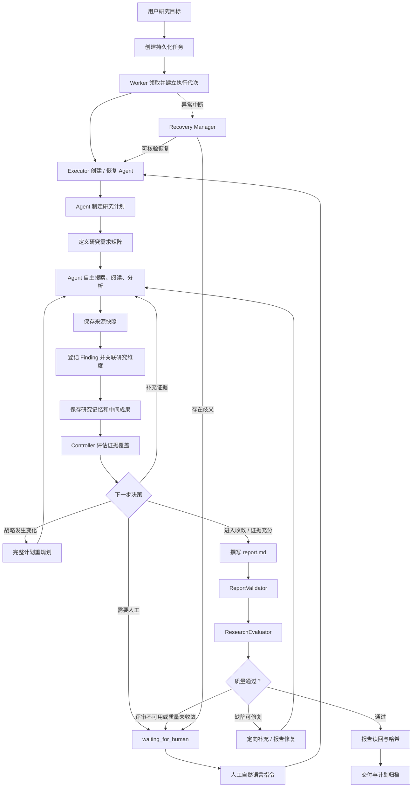

# 研究生命周期与可信交付设计

本文聚焦 Research 岗位的研究控制闭环，说明计划如何随证据演进、来源与 Finding 如何形成可追溯关系、质量门禁如何影响交付，以及长任务如何恢复。系统整体模块边界、存储所有权和技术取舍见 [系统架构与关键技术取舍](DESIGN_OVERVIEW.md)。

本文围绕自主研究、证据管理、动态控制、质量评估、长任务恢复和人工决策，说明研究任务从目标接收到可信交付的完整生命周期。

## 一、设计目标与基本原则

Agent 根据新获得的资料持续调整研究动作；系统通过证据登记、任务持久化、资源预算、质量评估和恢复控制，保障研究过程可追溯、任务可恢复、资源有边界、最终成果可验证。

当前闭环遵循五项原则：

1. **目标驱动而非步骤驱动**：用户提供目标和交付要求，Agent 负责选择研究路径。
2. **计划可演进**：初始计划用于表达战略，只有研究范围、假设、优先级或剩余工作发生实质变化时才创建新版本。
3. **结论关联证据**：Finding 关联来源 ID 和研究维度，形成研究主张、证据来源与研究问题之间的可追溯关系。
4. **建议与强制分层**：Controller 提供证据驱动建议，Agent 负责大部分研究决策；共享任务运行层对预算、任务控制和人工停车执行确定性约束。
5. **先核验再恢复**：进程中断后先判断工具副作用和 Checkpoint 状态，再决定是否重新执行。

## 二、模块职责与调用关系

| 模块 | 代码位置 | 职责 |
|---|---|---|
| Research Agent | `app/agents/research/agent.py`、`app/agents/research/system_prompt.md` | 规划、工具选择、研究分析、记忆和报告撰写 |
| Research Tool Service | `app/tools/research_tools.py` | 研究工具、计划、需求矩阵、Finding 和状态查询 |
| Evidence Registry | `app/infrastructure/evidence_registry.py` | 来源快照、来源元数据和 Finding 持久化 |
| Plan Progress Tracker | `app/runtime/plan_progress.py` | 计划步骤状态、工具关联和产物验证 |
| Research Controller | `app/runtime/research_controller.py` | 研究需求、覆盖率、关键缺口、停滞和行动建议 |
| Research Evaluator | `app/runtime/research_evaluator.py` | 规则评分、独立上下文评审、硬阻断和质量缺陷 |
| ReportValidator | `app/runtime/report_validator.py` | Markdown 结构和引用溯源检查 |
| Lifecycle Coordinator | `app/runtime/lifecycle_coordinator.py` | 在研究阶段边界与最终交付阶段协调 Controller 和 Evaluator |
| Recovery Manager | `app/runtime/recovery_manager.py` | 工具调用生命周期、未知副作用核验和 Checkpoint 检查 |
| Worker / Executor | `app/runtime/worker.py`、`app/runtime/executor.py` | 任务领取、Agent 执行、预算、恢复、修复和终态收尾 |

## 三、端到端研究闭环

### 3.1 任务状态与研究阶段是两个维度

任务状态由 SQLite 管理，包括 `queued`、`running`、`retry_wait`、`paused`、`waiting_for_human`、`completed`、`failed`、`cancelled`、`deleting` 和 `archived`。

研究阶段由 `PlanProgressTracker` 根据工具活动粗粒度映射为：

`scope → discovery → reading → analysis → report → validation`

阶段用于展示进度和触发观察点，不构成 Agent 必须依次执行的固定工作流。Agent 可以根据新证据返回前面的阶段，也可以重排计划。

## 四、研究计划与需求矩阵

### 4.1 战略计划

`update_research_plan` 用于创建初始计划或记录实质性重规划。模型工具契约要求：

- 一个计划包含标题、研究目标和 3–8 个步骤；
- 每个步骤具有唯一 ID、标题、目标和预期产物；
- 可选指定阶段、依赖关系和预期产物路径；
- 计划结构先经过 Pydantic 校验，校验失败不会增加版本或覆盖原计划。

初始计划记录版本 1。后续计划只有发生实质变化才增加版本；普通步骤开始、完成、跳过或工具调用不会创建战略计划版本。

### 4.2 重规划审计

每次实质性重规划必须提交完整的新计划，并填写五项信息：

| 字段 | 含义 |
|---|---|
| `trigger` | 触发重规划的事件或新条件 |
| `new_information` | 新获得的具体信息或证据 |
| `problem_analysis` | 原计划为何不足、受阻、被证伪或效率不佳 |
| `decision` | 根据证据作出的战略决策 |
| `changes` | 后续研究步骤、顺序、范围或交付如何变化 |

系统对比前后计划，保留未改变步骤的进度；新增或实质修改的步骤重新进入待执行状态。计划版本和步骤进度分别记录，便于区分“研究策略改变”和“工作推进”。

### 4.3 研究需求矩阵

Agent 通过 `define_research_requirements` 提交 3–12 个研究维度。每个维度包括：

- `id`、`title`；
- `questions`：需要回答的问题；
- `expected_evidence`：预期证据；
- `priority`：`critical`、`high` 或 `normal`；
- `min_sources`：最低有效来源数量。

可选 `quality_policy` 支持岗位提高默认总分和单维度质量门槛，岗位基线始终作为最低验收标准。

研究维度围绕用户真正关心的比较问题定义，并与研究阶段区分。Agent 未主动定义维度时，Controller 从现有计划派生后备维度，保持覆盖评估的完整性。

## 五、来源、Finding 与证据覆盖

### 5.1 证据登记簿 Evidence Registry

`EvidenceRegistry` 保存两类核心记录：

**来源（Source）**

- 稳定来源 ID，例如 `S0001`；
- 标题、URL、来源类型和获取时间；
- 正文内容哈希；
- 任务工作区中的快照路径；
- 来源验证状态。

网页、PDF、GitHub 文件和 arXiv 论文在成功提取后进入统一来源登记流程。搜索结果首先作为候选资料；完成内容读取、来源登记并形成关联 Finding 后，才计入对应研究维度的证据覆盖。

**研究发现（Finding）**

- Finding ID，例如 `F0001`；
- 结论或主张 `claim`；
- 关联来源 `source_ids`；
- 关联研究维度 `dimension_id`；
- 解释依据和置信度。

由此形成：

`研究维度 → Finding → Source ID → 来源快照 → 原始 URL`

报告使用 `[S0001]` 等来源 ID 支持正文主张，并在 Sources 章节提供直接 URL。Evidence Registry 提供来源摘要和快照读回能力。

### 5.2 覆盖率计算

Research Controller 不按搜索次数或搜索结果条数计算研究进度，而是沿 Finding 与来源关联计算：

`dimension → Finding(dimension_id) → source_ids → registered source snapshot`

对每个维度：

\[
coverage_i = \min\left(1,\frac{valid\_source\_count_i}{min\_sources_i}\right)
\]

只有被 Finding 关联、已登记且通过当前快照检查的来源才计入有效来源数量。

优先级权重为：

| 优先级 | 权重 |
|---|---:|
| critical | 3 |
| high | 2 |
| normal | 1 |

总体覆盖率为按优先级加权的维度覆盖率：

\[
Coverage = \frac{\sum_i w_i \cdot coverage_i}{\sum_i w_i}
\]

维度状态分为 `covered`、`partial` 和 `uncovered`。未完全覆盖的 critical 维度形成关键研究缺口。

### 5.3 停滞检测

Controller 持久化进度向量：

- `coverage_ratio`；
- `valid_source_count`；
- `finding_count`；
- `critical_gap_count`；
- `quality_total`。

当总体覆盖率提升至少 0.03、新增有效来源、新增 Finding、关键缺口减少或质量总分提升至少 2 分之一发生时，视为出现实质进展。只有 `phase_boundary`、`final_delivery` 和 `scheduled_checkpoint` 等周期触发器会累计停滞次数；普通状态查询是观察，不会被误计为一个研究周期。

连续两个符合条件的周期没有改善且仍存在关键缺口时，Controller 将任务标记为停滞，并建议人工介入。

## 六、Research Controller：建议与运行时约束

Controller 根据研究覆盖、停滞、质量评估状态和预算阶段，返回建议动作及允许动作：

| 动作 | 含义 |
|---|---|
| `FILL_EVIDENCE_GAP` | 针对未覆盖维度补充证据 |
| `REPLAN` | 根据新信息修改后续研究策略 |
| `CONTINUE_RESEARCH` | 沿当前方向继续研究 |
| `ENTER_CONVERGENCE` | 停止新增探索，优先综合和交付 |
| `REQUEST_HUMAN` | 将需要人工判断的情况交给操作人员 |

Controller 不直接搜索资料，也不替 Agent 写计划。Agent 通过 `get_research_status` 获取覆盖矩阵和行动建议，并根据上下文选择具体工具与研究动作。

共享任务运行层对两类情形执行确定性约束：

1. 预算进入收敛阶段后，工具层阻止新的搜索和来源读取，保留有限的综合、成果、记忆和证据操作。
2. 阶段边界评估返回 `REQUEST_HUMAN` 时，任务原子地进入 `waiting_for_human`，释放 Worker 所有权并创建人工待办。

因此，系统采用“Agent 自主研究决策 + Controller 证据反馈 + 共享任务运行层硬约束”的分层控制方式。

## 七、报告验证与质量评估

### 7.1 报告结构校验 ReportValidator

ReportValidator 执行确定性结构和溯源检查：

- 存在 Markdown 一级标题；
- 存在独立 Sources/References/参考资料章节；
- 正文长度达到最低要求；
- 正文和来源章节包含直接 URL；
- 正文引用的来源 ID 已在 Evidence Registry 登记；
- 正文引用来源的 URL 出现在 Sources 章节；
- 至少 40% 的合格正文段落包含有效来源引用（合格段落至少 80 个字符）；
- 使用 Finding ID 时，该 ID 必须存在于登记簿。

该组件验证报告结构和来源关联，不单独证明来源内容在语义上支持结论。

### 7.2 ResearchEvaluator 五维评估

| 维度 | 权重 | 主要评价内容 |
|---|---:|---|
| 目标覆盖度 | 20% | 研究维度和用户目标覆盖情况 |
| 证据充分性 | 25% | 各维度有效来源数量与最低证据要求 |
| 来源可靠性 | 20% | 已登记来源及快照可用性 |
| 结论一致性 | 20% | Finding 之间可能存在的矛盾 |
| 报告完整性 | 15% | 研究范围/方法、发现/分析、局限、结论和来源章节 |

规则评分与 LLM 评审默认按 60% / 40% 合成。默认加权总分至少 80 分，每个维度至少 60 分；任务的 `quality_policy` 可以提高门槛。

### 7.3 独立上下文评审

LLM Reviewer 通过独立的 ChatOpenAI 调用执行，使用与 Research Agent 相同的模型配置，并在独立上下文中完成质量评审。

评审上下文包含用户目标、研究需求、覆盖状态、规则评分、Finding、报告和有限来源摘录。输入有明确上限：报告最多 16,000 字符，最多 8 个来源且每个来源最多 1,000 字符摘录，最多 30 条 Finding，最终评审输入 JSON 最多 42,000 字符。

Reviewer 输出五维分数、unsupported claims、contradictions、missing dimensions 和 actionable repairs。评审响应必须符合结构化 JSON 契约；评审不可用时，生产流程不会将规则分数直接冒充为独立评审通过，而是创建人工待办。

### 7.4 修复与交付

研究岗位通过 Registry 注册 `max_revisions=3`，Executor 在初次验证后最多进行三轮交付修复。每轮修复只针对结构化缺陷补充研究或修订报告，避免重复已完成且有证据的工作。

交付前要求：

- 报告文件存在且非空；
- ReportValidator 通过；
- 不存在不可豁免硬阻断；
- 无 critical defects；
- 总分和单维度分数达到门槛；
- Reviewer 状态满足当前交付策略。

通过后，Executor 重新读取报告、计算 SHA-256 并记录 `report_delivered`。若评审不可用或有限修复后仍未达到质量门槛，则保留报告和评估记录，进入人工决策。

## 八、长任务执行、异常恢复与一致性

### 8.1 Worker 与任务状态

FastAPI 提供任务创建、查询与操作接口；Worker 在后台独立执行任务，通过 SQLite 全局租约协调单机单 Worker 运行，并周期性更新心跳。

领取任务时增加 `worker_generation`。数据库关键写操作在事务内重新检查任务状态、`worker_id` 和 `worker_generation`，防止失去所有权的旧 Worker 在新 Worker 接管后继续写入。

任务状态包括：

`queued`、`running`、`retry_wait`、`paused`、`waiting_for_human`、`completed`、`failed`、`cancelled`、`deleting`、`archived`。

### 8.2 图执行检查点 LangGraph Checkpoint

Executor 使用 `task_id` 作为 LangGraph `thread_id`。首次执行创建图状态；暂停、人工决策或失败重试后，在保留原任务 ID 和工作区的情况下读取 Checkpoint，继续尚未完成的图执行。

Checkpoint 保存 Agent 消息和图节点状态，不取代任务数据库，也不取代工作区中的研究资料。

### 8.3 工具调用生命周期

工具调用进入持久化台账，记录：

- `call_id`、工具名称和输入参数；
- 输入哈希和幂等键；
- `worker_generation`；
- running、succeeded、failed 或 unknown 状态；
- 结果摘要/哈希和错误信息。

`begin_tool_call` 将开始记录与事件原子写入；工具终态与对应事件也在同一数据库事务中提交。重复且一致的终态回调不会重复插入事件，矛盾终态会被拒绝。

### 8.4 恢复核验策略

Worker 心跳过期后，RecoveryManager 先将未完成调用标记为 unknown，再按工具类型核验：

| 工具类别 | 恢复策略 |
|---|---|
| 搜索、网页/PDF、GitHub、arXiv 等只读请求 | 远端响应状态在本地可能未知；按预算重新请求，并保留原调用记录 |
| `save_artifact` | 读取目标文件；内容与原始输入完全一致才确认成功 |
| `save_research_memory` | 读回研究记忆并核验内容 |
| `record_finding` | 检查登记簿是否已有完全匹配的 Finding |
| `update_research_plan` | 对比当前计划事件、计划文件和版本 |
| `update_plan_step_status` | 对比步骤状态、计划版本和已验证产物 |
| `define_research_requirements` | 对比当前研究要求矩阵 |
| 无法自动核验的工具 | 转入人工核验流程，由操作人员决定后续处理 |

恢复管理器还会检查 Checkpoint SQLite 数据库、表结构和对应 `thread_id`。如果发现 Checkpoint 损坏或工具副作用存在歧义，任务进入 `waiting_for_human`；只有能够安全恢复时才重新入队并复用原 Checkpoint。

这是一种保守的副作用核验机制，不宣称外部服务 exactly-once。只读外部请求在恢复后可能重复发送；已知写操作只有在持久化事实能够证明时才自动确认。

### 8.5 错误分类和重试

共享任务运行层将错误区分为任务控制信号、可重试错误和终态错误。网络超时、限流和上游服务暂时不可用等错误可进入有限重试；认证、权限、不可恢复参数和明确硬预算耗尽等情况进入终态处理。

默认重试采用有上限的指数退避。操作人员可通过任务重试接口重新入队，复用已有 Checkpoint 和工作区。

## 九、资源预算与收敛

研究岗位默认资源预算：

| 资源 | 默认值 |
|---|---:|
| 工具调用次数 | 30 |
| 累计运行时间 | 3,600 秒 |
| Token | 100,000 |

模型调用前，共享任务运行层预留启发式输入 Token 估算、4,096 Token 输出上限和 256 Token 固定开销；模型响应后可用时使用 Provider usage 结算。Token 估算用于预算保护，不等同于 Provider 精确计量。

收敛阶段保护：

- Token 预算的 30%；
- 工具调用次数的 25%；
- 累计运行时间的 20%。

预留还受最小值和最多预留总额一半的规则约束。当探索额度触及收敛边界时，系统阻止新的搜索和来源读取，将剩余额度用于证据整理、报告综合、保存、读回、验证和修复。预算硬上限仍然生效；扩额需要操作人员明确批准。

## 十、人工干预与自然语言决策

人工干预通过自然语言指令完成，运行时将用户意图交给 Agent 转化为结构化研究要求或计划调整。

当前主要待办类型包括：

- 研究停滞且关键维度仍有缺口；
- 独立质量评审不可用；
- 有限修复后质量仍未达到门槛；
- Checkpoint 或工具副作用无法安全核验。

API 接收 `action`、自然语言 `instruction`、`reason` 和必要的 `confirm`。系统校验待办允许的动作并保存决策；操作人员以自然语言提交研究要求，由 Agent 转换为结构化研究维度矩阵。

任务恢复时，Executor 将人工指令以稳定消息 ID 注入 Agent 上下文。Agent 读取人工决策和当前研究状态，再决定如何处理：

- 补充研究要求：保留已有维度，将用户自然语言转化为完整研究需求矩阵；
- 改变研究方向：按五项审计字段提交完整的新计划；
- 继续研究或修复：保留已验证工作，优先处理尚未解决的问题；
- 批准降级交付：必须显式确认并填写原因，报告读回核验后记录人工批准；
- 终止：结束任务并保留审计记录。

若 Checkpoint 停留在待执行工具节点，新的人工指令优先于尚未执行的旧工具批次；系统保留这一替代关系的执行记录，确保后续行动与人工决策一致。

## 十一、可观测性与开发者诊断

任务事件在写入 SQLite 后通过 SSE 推送。事件 ID 单调递增，前端可通过 `Last-Event-ID` 或 `after_id` 续传。

开发者可以从不同视角检查同一任务：

| 观察对象 | 主要问题 |
|---|---|
| 事件时间线 | 任务按什么顺序执行，哪里发生错误或重试 |
| 模型调用 | 使用了什么可观察输入/输出，耗时和 Token 如何 |
| 工具调用 | 调用了什么工具、参数和结果是什么、是否存在未知副作用 |
| 研究计划 | 当前战略、版本历史和步骤进度是什么 |
| 证据登记簿 | 哪些来源被读取，哪些 Finding 支持哪些维度 |
| 研究控制状态 | 覆盖率、关键缺口、停滞和建议动作是什么 |
| 质量评估 | 哪些维度未达标，硬阻断和修复建议是什么 |
| 预算与恢复 | 资源消耗、收敛阶段、恢复核验结果和人工待办是什么 |
| Artifact | 中间成果和最终报告实际保存了什么 |

执行轨迹记录模型和工具的可观察输入、输出、耗时和错误，不记录隐藏思维链。

## 十二、关键设计验证

| 测试 | 验证目标 |
|---|---|
| `tests/test_autonomous_research_e2e.py` | 实际工具证据改变时，模型决策是否相应改变；矛盾证据触发重规划，支持性证据保留原计划；质量反馈驱动定向修复 |
| `tests/test_process_crash_recovery.py` | 在 Artifact 写入、工具调用开始和 Checkpoint 保存等真实子进程边界中断后，能否核验副作用并安全恢复 |
| `tests/test_worker_fencing_races.py` | Worker 接管、执行代次隔离、终态竞争和事务回滚 |
| `tests/test_recovery_consistency.py` | 不同工具类型的恢复策略和跨存储一致性 |
| `tests/test_research_lifecycle.py` | 研究需求、覆盖率、停滞、质量评估和人工干预 |
| `tests/test_report_validator.py` | 报告结构、来源 ID、URL 和段落级引用检查 |
| `tests/test_budget_gates.py` | 工具、Token 和运行时间预算闸门 |
| `tests/test_role_extensibility.py` | 第二岗位在测试环境中复用共享 API、Worker、Executor、Checkpoint 和预算 |
| `tests/test_documentation.py` | 文档编码、源码路径引用和关键设计声明 |

自动化测试使用确定性模型和 HTTP 测试替身，覆盖生产 Builder、Worker、Executor、SQLite 与 Checkpoint 的控制链路，以及工具副作用核验、任务恢复和岗位运行时复用。

## 十三、实现范围

当前版本以单机单 Worker 和 Research Agent 为运行基线。Agent Registry 通过岗位独立 Builder、Profile、产物、校验、修复、Finalizer 和预算契约承载岗位差异；测试专用分析岗位复用共享任务运行层接口。后续可沿该架构扩展多 Worker 并发、多主机调度和多岗位生产编排。

系统围绕 **Agent 自主研究 → 证据登记与覆盖评估 → 根据新信息调整计划 → 质量门禁与有限修复 → 任务持久化、异常恢复和过程审计** 组织完整研究闭环。
