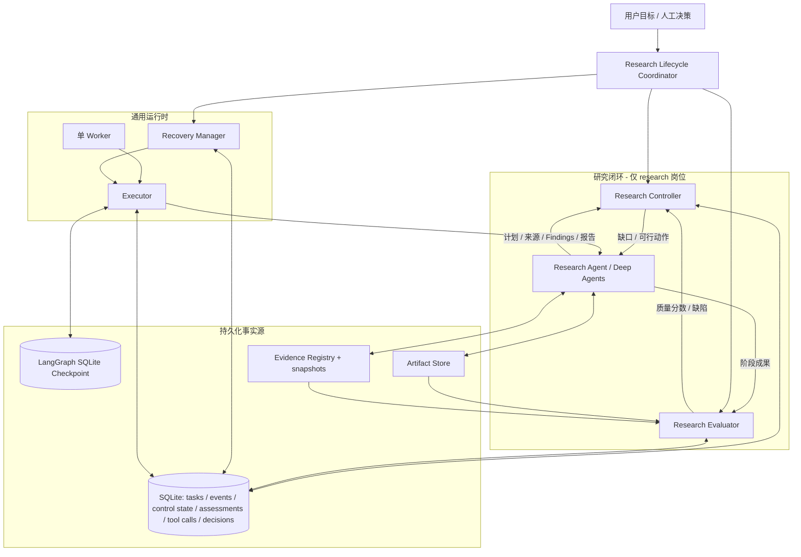
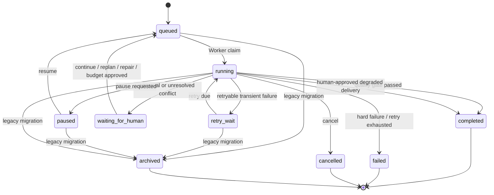

# 可信研究闭环：Research Controller / Evaluator / Recovery Manager 设计

> 状态：施工基线设计  
> 适用版本：单机、单 Worker、SQLite、Deep Agents + LangGraph  
> 目标：让系统不仅能执行研究，还能判断研究是否充分、在证据变化时调整策略，并在进程中断后安全恢复。

## 1. 设计目标与非目标

### 1.1 目标

1. 研究目标被显式拆成可追踪的研究维度、问题和证据要求。
2. 研究进展由持久化证据驱动，而不是仅依赖 Agent 的自然语言自述。
3. 质量评估同时包含确定性规则和独立 LLM 评审；严重缺陷不能被平均分掩盖。
4. 研究控制决策经过规则约束，LLM 只在允许的行动集合内选择策略。
5. Worker 崩溃后，任务数据库、LangGraph Checkpoint、Artifact、Evidence Registry 和工具调用记录经过协调再恢复。
6. 研究成果、质量评估、控制决策、恢复决策和人工决策均可追溯。
7. 单 Worker 仍是唯一执行者；本次不引入分布式调度。

### 1.2 非目标

- 不把 LLM 的“自我感觉完成”作为交付标准。
- 不承诺跨 Tavily、GitHub、arXiv 等外部服务的 exactly-once；不支持幂等键的外部只读请求只能做到可审计、可核验和安全重试。
- 不在本阶段引入 PostgreSQL、Redis、消息队列、多 Worker 或 Kubernetes。
- 不对历史任务迁移旧 Checkpoint；旧任务仅供查询和复盘。
- 不把代码行数、页面数量或模型调用次数作为质量指标。

## 2. 架构



### 2.1 职责边界

| 组件 | 唯一职责 | 不负责 |
|---|---|---|
| Research Controller | 研究目标规范化、证据覆盖矩阵、缺口和停滞检测、候选行动约束 | 不调用外部搜索、不直接改写 Agent 计划 |
| Research Evaluator | 五维质量评分、硬门槛、独立 LLM 评审、缺陷诊断 | 不自行安排研究步骤、不改变预算 |
| Recovery Manager | 工具调用日志、未知结果核验、多源状态协调、故障分类和恢复建议 | 不评价研究内容质量 |
| Lifecycle Coordinator | 串联阶段、检查状态合法性、预算与终止条件 | 不取代上述三个模块内部算法 |
| Executor | 调用 Agent、回调、报告持久化与交付 | 不在 Executor 中堆叠研究策略规则 |
| Worker | 领取任务、心跳、执行、等待、重试 | 不自行猜测研究状态 |

### 2.2 决策原则

采用“确定性规则先缩小可行集合，LLM 在可行集合中做策略选择”的两层决策：

1. 规则层依据硬预算、任务状态、证据缺口、质量硬门槛和停滞情况生成 allowed_actions。
2. Agent/LLM 只可在 allowed_actions 中选择 CONTINUE_RESEARCH、FILL_EVIDENCE_GAP、REPLAN、ENTER_CONVERGENCE、REQUEST_HUMAN 等动作。
3. Coordinator 再次校验动作，非法动作不执行并记录拒绝原因。
4. 决策输入、规则指标、LLM 输出、最终动作和后续效果均写入事件及控制状态。

## 3. 生命周期状态机

### 3.1 任务状态



### 3.2 研究生命周期阶段

`planning → evidence_collection → analysis → draft → evaluation → repair/research → convergence → delivered`

阶段不是任务状态的替代物。任务 status 表示运行生命周期；research_control_state.phase 表示研究阶段。阶段切换必须由 Coordinator 持久化，不能由前端推断。

### 3.3 终止条件

- **通过交付**：五维总分达到岗位阈值、所有单项达到阈值、无不可豁免硬缺陷。
- **降级交付**：仅存在允许人工豁免的缺陷，用户明确批准，报告中附带限制说明。
- **等待人工**：预算扩额、方向决策、LLM 评审连续失败、无法确定的状态冲突。
- **失败**：不可豁免硬缺陷无法修复、不可恢复 Checkpoint 损坏、硬预算终止且无可用恢复路径、重试上限耗尽。
- **收敛**：达到预算探索边界、研究质量停滞、无高收益缺口时，停止探索并尝试综合现有证据；收敛不等于自动通过质量门槛。

## 4. Research Controller 设计

### 4.1 研究覆盖矩阵

Agent 在初始计划后调用 `define_research_requirements`，提交：

```json
{
  "version": 1,
  "dimensions": [
    {
      "id": "planning",
      "title": "任务规划机制",
      "questions": ["如何拆解任务并更新计划？"],
      "expected_evidence": ["官方文档", "实现源码", "技术论文"],
      "priority": "critical",
      "min_sources": 2
    }
  ]
}
```

字段规则：
- id 在同一版本内唯一；保留未改变维度 ID。
- priority 仅允许 critical/high/normal。
- min_sources 范围 1–10。
- Agent 可以新增、细化或合并维度，但每次实质变更需解释 trigger、new_information、problem_analysis、decision、changes。
- 岗位和全局硬门槛不能由 Agent 降低。

如果 Agent 未调用该工具，Controller 从首个 research_plan_updated 的 steps 生成保守 fallback 维度，明确标记 source=plan_fallback，避免空矩阵被误判为完整。

### 4.2 证据归属

`record_finding` 增加可选 dimension_id。一个 finding 可以关联多个 source_id，但一个 finding 只能归属一个主维度；跨维度结论可重复记录并共享来源。覆盖率以 Finding→Source 的有效链路为主，不以搜索结果 snippet 数量充数。

维度状态：
- uncovered：无有效 Finding。
- partial：有有效 Finding，但有效来源数量不足或证据类型未满足。
- covered：达到 min_sources 且来源快照通过校验。
- blocked：关键来源不可访问、证据互相矛盾或存在未解决假设。

Controller 输出 dimension-level gap、critical gap、coverage_ratio、有效来源数量、来源类型分布和待解决问题。

### 4.3 触发机制

事件驱动 + 阶段性：
- 立即触发：关键来源不可访问、快照完整性失败、Finding 冲突、研究假设被推翻、预算进入 convergence、人工决策应用。
- 阶段触发：完成一个研究阶段、累计新增 3 个来源或 2 个 Finding、准备进入报告撰写、报告评估结束。
- 普通工具调用不触发 LLM 控制决策；仅更新轻量统计。

### 4.4 停滞检测

每个评估周期生成进度向量：
`(coverage_ratio, valid_source_count, finding_count, quality_total, critical_gap_count)`。
与上次周期比较，满足以下全部条件视为一次“无实质改善”：
- coverage_ratio 增量 < 0.03；
- 有效来源新增 < 1；
- 新增有效 Finding < 1；
- 关键缺陷数量未下降；
- 若已有质量评分，总分提升 < 2。

连续两次无实质改善进入收敛候选；若仍存在关键缺口，优先请求人工判断，而不是伪造“已充分”。

## 5. Research Evaluator 设计

### 5.1 五维评分

默认研究员权重：

| 维度 | 权重 | 规则侧主要依据 |
|---|---:|---|
| 研究目标覆盖度 | 20% | 已覆盖研究维度 / 总维度，critical 加权 |
| 证据充分性 | 25% | 有效 Finding、每维有效来源数、证据类型要求 |
| 来源可靠性 | 20% | 快照完整性、来源类型、原始/官方来源比例 |
| 结论一致性 | 20% | Finding 冲突、相互矛盾的结论、引用链完整性 |
| 报告完整性 | 15% | 目标章节、方法/范围、结论、局限、来源、正文长度 |

总分至少 80；每项至少 60。权重由岗位 Profile 配置，必须合计 100。任务可提高某项要求或增加额外的硬性约束，但不得降低岗位基线。

### 5.2 双层评估

**规则层**必须先运行，计算可复现的指标并识别硬缺陷。**LLM 层**使用同一 OPENAI_MODEL，但独立发起调用，不继承 Agent 对话历史，只接收：
- 用户目标和结构化研究维度；
- 计划及预期产物；
- 报告正文；
- 证据登记簿中的来源元数据和 Finding；
- 规则评分及明确缺陷。

LLM 输出严格 JSON：dimension_scores、unsupported_claims、contradictions、missing_dimensions、actionable_repairs、summary。模型分数与规则分数分别保存；合成分数按 60% 规则 + 40% LLM，规则硬门槛具有最终否决权。评审调用通过现有 TaskEventCallback 计入 Token 预算。

### 5.3 硬门槛与豁免

不可豁免：
- 伪造或不存在的来源 ID；
- 来源快照哈希/完整性校验失败；
- 证据登记簿损坏或引用源无法确认；
- 报告为空、交付文件读回不一致。

可人工豁免但必须披露：
- 某个非核心维度覆盖不足；
- 某项证据数量不足但已有可信替代证据；
- 结论存在未解决但已明确披露的争议；
- 受外部服务限制而无法获取某类资料。

LLM 评审失败最多重试 2 次（指数退避）；仍失败进入 waiting_for_human，保留报告，不把“评审不可用”当成“评审通过”。

### 5.4 修复策略

- 每轮评估生成 defect_id、severity、affected_dimension、evidence_gap、repair_action、expected_quality_gain、estimated_cost。
- Controller 根据严重程度、预计收益和剩余预算排序。
- Agent 收到结构化缺陷，执行定向研究/重规划/报告修复。
- 每次修复后重新执行规则 + LLM 评估。
- 修复次数由岗位 Profile 配置；默认 2 轮。
- 连续两轮无实质质量提升时触发停滞决策。

## 6. Recovery Manager 设计

### 6.1 多源事实边界

| 数据源 | 权威范围 |
|---|---|
| tasks | 任务所有权、状态、预算和 Worker generation |
| events | 有序审计事实，不单独代表外部副作用完成 |
| LangGraph Checkpoint | Agent 图状态和待执行节点 |
| Artifact Store | 报告、计划、记忆、源快照文件内容 |
| Evidence Registry | 来源/Finding 元数据与 ID 关系 |
| tool_calls | 单次工具调用生命周期、参数摘要、执行结果/未知状态 |

不采用“某一个数据库覆盖所有状态”的简单优先级。恢复时逐项校验；只有能从文件哈希、唯一 ID、Checkpoint pending nodes 等确定性事实推导时才自动修复。

### 6.2 工具调用生命周期

状态：prepared → running → succeeded / failed / unknown。

记录：
- call_id、idempotency_key、tool_name；
- 参数 JSON（脱敏、长度限制）和参数哈希；
- worker_generation、started_at、completed_at、attempts；
- 结果摘要/哈希、错误分类；
- 对应事件 ID、checkpoint thread_id、source_id/Finding ID。

工具分类：
- 只读搜索/网页/GitHub/arXiv：unknown 时允许重新执行；保留调用历史，明确可能产生重复请求。
- Evidence 写入：检查 source_id、snapshot_path、content_hash；已完整登记则标记成功，快照存在但登记缺失时进入核验，不盲目生成新 ID。
- Artifact 写入：按路径和内容哈希读回核验；内容一致则标记成功，否则重试写入或人工介入。
- 状态变更：先读取数据库当前状态和事件；若目标状态已生效则标记成功。
- 无法判断的调用：进入 waiting_for_human。

### 6.3 恢复协调算法

1. 获取任务与 worker_generation；拒绝旧 generation 的迟到写入。
2. 检查 Checkpoint 是否存在、是否有 pending nodes；Checkpoint 损坏不自动重建。
3. 扫描 running 工具调用，转为 unknown 并按工具类型核验。
4. 校验最终报告路径、内容哈希、交付事件及 Evidence Registry。
5. 若 Artifact 已完整、Checkpoint 已结束、质量评估通过但任务未 completed，则只补写任务完成状态。
6. 若 Checkpoint 有 pending nodes 且所有不确定副作用已核验，按原 thread_id 恢复。
7. 若多源冲突无法证明唯一正确状态，保留现场并进入 waiting_for_human。
8. 每次恢复决策写入 recovery_decisions 和事件。

## 7. SQLite 增量迁移

新增迁移版本表 `schema_migrations`，所有迁移在单个 `BEGIN IMMEDIATE` 事务内完成。

### 7.1 tasks 增量字段

- runtime_generation INTEGER：1=legacy/history only，2=current lifecycle。
- archived_from_status TEXT：记录迁移前的活动状态。

升级时：
- 既有任务 runtime_generation=1。
- 既有 queued/running/retry_wait/paused 等活动任务统一转 archived，记录 archived_from_status。
- completed/failed/cancelled 历史终态保留原状态，但禁止 retry。
- 新任务显式 runtime_generation=2。
- Worker 只领取 generation=2。
- 不迁移旧 Checkpoint；旧 Artifact 和事件只读保留。

新增 waiting_for_human 状态。

### 7.2 新表

| 表 | 主键 / 约束 | 用途 |
|---|---|---|
| research_control_state | task_id PK, FK tasks | 需求矩阵、阶段、周期、覆盖指标、停滞计数 |
| quality_assessments | assessment_id PK, FK tasks | 五维评分、硬缺陷、LLM 评审、评估输入摘要 |
| tool_calls | (task_id, call_id) PK；UNIQUE(task_id,idempotency_key) | 工具调用生命周期 |
| recovery_decisions | recovery_id PK, FK tasks | 恢复核验、冲突和决策 |
| human_interventions | intervention_id PK, FK tasks | 人工请求、决策、操作者和时间 |

JSON 列只保存结构化快照；高频筛选字段独立列并建立索引。事件日志仍是 append-only 审计记录，不用 JSON 事件代替关键唯一约束。

### 7.3 迁移安全

- 迁移前备份 tasks.sqlite 和 checkpoints.sqlite。
- 每个迁移版本幂等执行。
- 迁移失败回滚整个版本，不允许半迁移。
- 启动时校验 schema version；未知更高版本时拒绝写入并提示降级版本不兼容。

## 8. 核心接口

### Research Controller

- `define_requirements(task_id, requirements, source="agent") -> RequirementSnapshot`
- `ensure_requirements(task_id, plan) -> RequirementSnapshot`
- `assess_coverage(task_id, registry, plan) -> CoverageSnapshot`
- `evaluate_progress(task_id, trigger) -> ControllerDecision`
- `record_decision(task_id, decision, rationale, metrics) -> None`

### Research Evaluator

- `evaluate_rules(task, report, requirements, registry) -> RuleAssessment`
- `review_with_llm(task, report, context, callback) -> LLMReview`
- `evaluate(task, report, callback, allow_llm=True) -> QualityAssessment`
- `classify_defects(assessment) -> list[Defect]`

### Recovery Manager

- `begin_tool_call(task_id, call_id, tool_name, input, generation) -> ToolCallRecord`
- `finish_tool_call(task_id, call_id, output) -> None`
- `fail_tool_call(task_id, call_id, error) -> None`
- `reconcile_task(task_id, checkpoint_snapshot, artifacts) -> RecoveryDecision`
- `reconcile_unknown_tool_call(record, artifacts, registry) -> RecoveryDecision`

### Lifecycle Coordinator

- `on_plan_updated(task_id)`
- `on_research_evidence_changed(task_id, trigger)`
- `before_report(task_id)`
- `evaluate_delivery(task_id, report, callback)`
- `apply_decision(task_id, decision)`
- `resolve_human_intervention(task_id, action, payload)`

## 9. 关键伪代码

### 9.1 研究控制

```python
def control_cycle(task_id, trigger):
    requirements = controller.ensure_requirements(task_id, latest_plan())
    coverage = controller.assess_coverage(requirements, evidence_registry())
    budget = db.get_budget_status(task_id)

    allowed = rules.allowed_actions(
        coverage=coverage,
        budget=budget,
        quality=latest_quality(),
        stagnation=controller.stagnation_state(),
    )

    if budget.hard_exhausted:
        return persist(REQUEST_HUMAN_OR_TERMINATE)
    if coverage.has_critical_gap and "FILL_EVIDENCE_GAP" in allowed:
        return ask_agent_to_fill_specific_gaps(coverage)
    if coverage.strategy_invalid and "REPLAN" in allowed:
        return ask_agent_to_replan(coverage, evidence_delta)
    if "ENTER_CONVERGENCE" in allowed:
        return persist(ENTER_CONVERGENCE)
    return persist(CONTINUE_RESEARCH)
```

### 9.2 质量评估与修复

```python
def evaluate_delivery(task, report):
    rules = evaluator.evaluate_rules(task, report, requirements, registry)
    if rules.non_waivable_blocks:
        return WAIT_OR_FAIL(rules.non_waivable_blocks)

    review = evaluator.review_with_llm(
        isolated_context=goal_plan_evidence_report(rules, report),
        callbacks=[task_budget_callback],
    )
    quality = evaluator.combine(rules, review, profile.weights)
    db.save_assessment(quality)

    if quality.passed:
        return DELIVER
    if quality.repairable and budget.can_repair(quality.estimated_cost):
        return TARGETED_REPAIR(quality.defects)
    if quality.requires_human:
        return WAIT_FOR_HUMAN(quality)
    return CONVERGENCE_OR_FAIL(quality)
```

### 9.3 崩溃恢复

```python
def recover(task):
    assert task.runtime_generation == 2
    snapshot = load_checkpoint(task.task_id)
    calls = db.running_tool_calls(task.task_id)

    for call in calls:
        decision = recovery.reconcile_unknown_tool_call(call)
        persist(decision)
        if decision.is_ambiguous:
            return wait_for_human(decision)

    state = recovery.reconcile_artifact_evidence_checkpoint(task, snapshot)
    if state.is_ambiguous or state.checkpoint_corrupt:
        return wait_for_human(state)
    if state.deliverable_already_valid:
        return finalize_completion_without_research()
    return resume_same_checkpoint_thread()
```

## 10. API 与前端可观测

只新增围绕单任务生命周期的 API，不创建独立微服务：

- GET `/tasks/{id}/research-state`：需求矩阵、覆盖率、缺口、控制器建议。
- GET `/tasks/{id}/quality`：历史评估、五维评分、硬缺陷和修复项。
- GET `/tasks/{id}/recovery`：工具调用、恢复决策和冲突现场。
- POST `/tasks/{id}/interventions/{intervention_id}/decision`：人工决策。
- POST `/tasks/{id}/continue`：对 waiting_for_human 任务按允许动作恢复。

前端展示研究维度覆盖、最近质量评分、修复建议、预算收敛原因、恢复决策、待处理人工请求。实时刷新仍复用 SSE 事件，不建立第二套推送通道。

## 11. 验收用例

所有测试纯离线：Mock 模型与外部服务，真实 SQLite、ArtifactStore 和 LangGraph SqliteSaver。

| ID | 场景 | 必须证明的结果 |
|---|---|---|
| RC-01 | Agent 提交研究维度 | 维度规范化、持久化，重复提交幂等 |
| RC-02 | 某 critical 维度无来源 | 识别 gap，输出 FILL_EVIDENCE_GAP |
| RC-03 | 新证据推翻旧 Finding | 生成冲突事件，允许 REPLAN，不静默覆盖 |
| RC-04 | 两个周期无实质进展 | stagnation_count 达阈值并进入收敛候选 |
| EV-01 | 五维规则评分 | 权重计算、单项线和总分线正确 |
| EV-02 | 伪造 source_id | 不可豁免硬阻断 |
| EV-03 | 快照 hash 不匹配 | 不允许交付，进入恢复/人工处理 |
| EV-04 | LLM JSON 格式错误/超时 | 有限重试，失败后 waiting_for_human |
| EV-05 | LLM 评审独立上下文 | 不包含 Agent 历史消息；调用计入预算 |
| RM-01 | Worker 崩溃于工具开始后 | running 调用转 unknown 并分类核验 |
| RM-02 | Artifact 已写但结束事件未写 | 哈希一致则标记工具成功，不重复覆盖 |
| RM-03 | Evidence 快照已写、Registry 未确认 | 不分配新 ID，保留冲突并等待核验 |
| RM-04 | Checkpoint 与数据库无法协调 | 保留现场，进入 waiting_for_human |
| RM-05 | 旧活动任务升级 | 归档、不可被 Worker 领取或 retry |
| LC-01 | 缺口→补充研究→质量通过 | 完整闭环交付，所有决策可追溯 |
| LC-02 | 质量不达标且预算耗尽 | 不假通过；等待扩额或降级决策 |
| LC-03 | 人工修改研究方向 | 决策持久化，原 Checkpoint 恢复并收到新指令 |
| LC-04 | 长事件超过 5000 条 | 最新状态和计划读取正确，无旧事件截断 |

### 11.1 核心不变量

1. completed 必须有已读回验证的非空交付物。
2. 不可豁免质量硬缺陷存在时不能 completed。
3. stale worker generation 不能修改当前任务状态或结算预算。
4. waiting_for_human 不得被 Worker 自动领取。
5. unknown 工具调用必须经过类型核验，不能默认重放所有副作用。
6. 证据快照和 Artifact 只允许可证明的确定性修复；不确定时保留现场。
7. 研究计划步骤 completed 必须有对应 expected_output 或明确的验证事件。
8. 任何自动重试都受全局重试次数、Token、工具调用次数和运行时长硬上限约束。
9. 质量评审调用计入同一任务预算。
10. 旧任务不进入新生命周期执行器。

## 12. 实施顺序

1. SQLite schema migration、legacy archive、waiting_for_human 和事件分页。
2. Recovery Manager：工具调用生命周期、未知结果核验、多源恢复决策。
3. Research Controller：需求矩阵、覆盖率、缺口和停滞检测。
4. Research Evaluator：五维规则评分、独立 LLM 评审、硬门槛与修复反馈。
5. Lifecycle Coordinator：将模块接入 Executor / Worker 的明确阶段边界。
6. API 和前端观测、人工决策。
7. 离线故障注入和完整闭环验收。

每一步都先建立可验证的不变量，再进入下一步；不以一次大改覆盖现有稳定功能。
