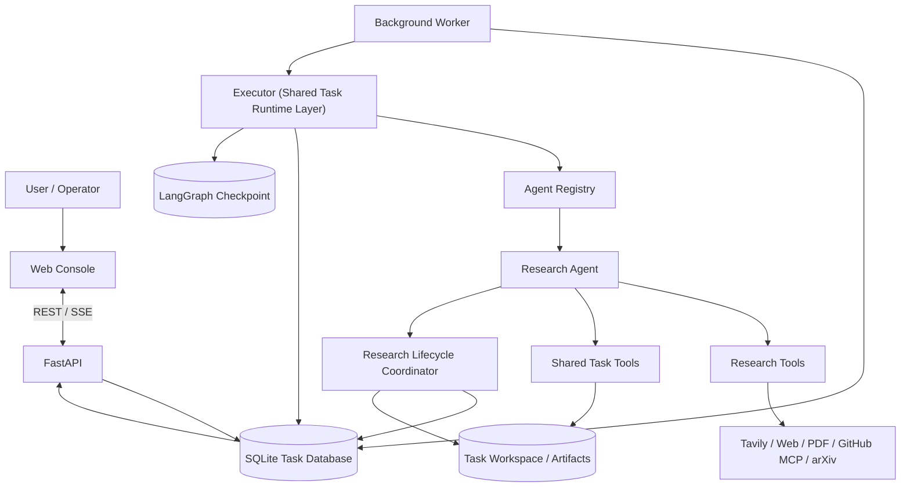
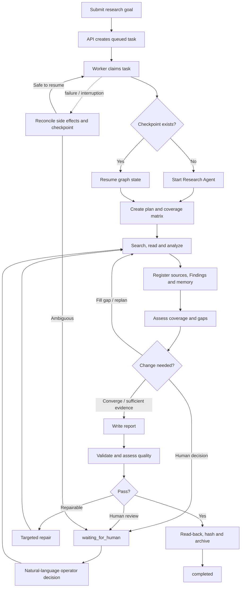

# Research Digital Employee

A long-running autonomous research system built with **Deep Agents, LangGraph, FastAPI and SQLite**. A user submits a research goal; the Research Agent creates and adapts its plan, searches and reads external sources, records evidence and findings, saves intermediate artifacts, and produces a source-backed Markdown report. A separate Worker executes tasks independently of the browser session, keeping long-running research active while users leave the console.

The project addresses the central challenge in the development exercise: researching leading Coding Agent architectures and comparing planning, tool use and context management in a source-backed Markdown report. Such work may take tens of minutes or longer. New evidence can change the best next action, while persistent state and recovery preserve task progress across model/provider failures and process interruptions. Developers can inspect how a result was produced and distinguish role-specific capabilities from the services provided by the shared task runtime layer.

## What the project demonstrates

| Exercise requirement | Implementation |
|---|---|
| Autonomous research and adaptive planning | The Agent chooses searches, reads, analysis and follow-up actions; material strategy changes are recorded as plan revisions |
| External search, reading and intermediate artifacts | Tavily, web/PDF retrieval, GitHub MCP, arXiv, task-scoped artifacts, durable memory and an evidence registry |
| Long-running execution and production failures | Independent Worker, SQLite task state, LangGraph checkpoints, lease/heartbeat, retries, budgets and conservative recovery |
| Understand and diagnose task execution | Persistent event journal, model/tool call records, SSE replay, plan snapshots, evidence, budget, quality and recovery records |
| Separate role capabilities from shared capabilities | Agent Registry defines role contracts; task lifecycle, Worker, persistence, budget and audit are provided by the shared task runtime layer |
| Technology choice is open | Uses Python, Deep Agents, LangGraph, FastAPI, SQLite and an OpenAI-compatible model endpoint; components can be replaced as role and deployment needs evolve |
| Operator interface and engineering focus | The web console supports task control, execution inspection and human decisions; engineering effort is centered on Agent autonomy, persistence, evidence, recovery and verification |

The system places an autonomous research Agent inside a durable task lifecycle with evidence feedback, resource boundaries, delivery validation and recovery.

## Architecture



| Component | Responsibility |
|---|---|
| FastAPI operator API | Task creation and controls; role, event, plan, research, evidence, budget and artifact inspection; human decisions |
| Agent Registry | Role builder, profile, output artifact, validator, repair handler, finalizer and default budget |
| Research Agent | Autonomous planning, tool selection, evidence gathering, analysis, memory and report writing |
| Shared task tools | Task-scoped artifact I/O, durable memory, budget inspection and extension requests |
| Research tools | Web search, webpage/PDF retrieval, GitHub repository/source inspection and arXiv |
| Research Controller | Evidence coverage, critical gaps, stagnation and bounded next-action recommendations |
| ResearchEvaluator / ReportValidator | Report provenance and structure checks, rule-based scoring and isolated-context review |
| Worker / Shared Task Runtime Layer | Task claiming, lease/heartbeat, checkpointing, budget gates, error classification, retries, recovery and finalization |
| Persistence and audit | SQLite task/control/event records, LangGraph checkpoints, workspace artifacts and tool-call journal |

### Persistence ownership

- `data/tasks.sqlite` stores task state, Worker ownership and generation, budgets, events, tool calls, research control, quality assessments, recovery decisions and human interventions.
- `data/checkpoints.sqlite` stores LangGraph graph state and message history, keyed by `task_id` as `thread_id`.
- `workspaces/{task_id}/` stores plan versions, research memory, source snapshots, the evidence registry, intermediate artifacts and the final report.

These stores have distinct responsibilities: the task database records business state, the checkpoint preserves Agent execution context, and the workspace holds research material and deliverables. Recovery reconciles state and side effects across all three stores.

## Research lifecycle

1. **Accept a goal.** The API validates the requested role, creates a durable task and applies role-level budget defaults.
2. **Claim in the background.** The Worker obtains the global lease, claims the task and increments `worker_generation`. The browser provides task operation and observation; the Worker owns background execution.
3. **Plan the research.** The Agent creates a structured plan of 3–8 steps and a coverage matrix of 3–12 research dimensions.
4. **Research autonomously.** The Agent chooses searches, webpage/PDF reads, GitHub inspection or arXiv retrieval. Successfully extracted sources are snapshotted; important conclusions become Findings linked to source IDs and research dimensions.
5. **Adapt to evidence.** The Research Controller measures dimension coverage, critical gaps and stagnation, then returns bounded recommendations. The Agent chooses and performs most research actions based on the observed evidence.
6. **Synthesize and validate.** The Agent writes `report.md`. ReportValidator checks structure, source IDs, URLs and paragraph-level citation coverage. ResearchEvaluator assesses five quality dimensions.
7. **Repair or request a decision.** Structured defects guide up to three delivery-repair rounds. Review unavailability, unresolved quality issues or ambiguous recovery can park the task for a human decision.
8. **Persist delivery.** The report is read back and hashed; the role finalizer archives the plan and execution outcome.



## Research tools and evidence

| Tool | Purpose |
|---|---|
| `web_search` | Search public web sources through Tavily |
| `fetch_url` | Read public webpage content and save a source snapshot |
| `fetch_pdf` | Download public PDFs, extract text by page and register evidence |
| `github_repo` / `github_tree` / `github_read` / `github_releases` | Read-only GitHub repository, directory, source and release inspection |
| `arxiv_search` / `arxiv_paper` | Search the official arXiv Atom API and retrieve papers |
| `save_artifact` / `read_artifact` / `list_artifacts` | Save, read bounded excerpts from and list task artifacts |
| `save_research_memory` / `read_research_memory` | Preserve progress across context compaction and process restarts |
| `define_research_requirements` / `get_research_status` | Define and inspect the research coverage matrix |
| `record_finding` / `get_evidence_registry` | Record evidence-linked claims and inspect the evidence ledger |
| `update_research_plan` / `update_plan_step_status` / `set_active_plan_step` | Manage strategy revisions, step progress and tool-to-step correlation |

Source snapshots receive stable IDs such as `[S0001]` and content-hash metadata. Findings connect claims to source IDs and research dimensions. Important report claims cite `[Sxxxx]`; the Sources section includes direct URLs, creating a traceable path from the report to stored source material.

GitHub access uses the official hosted read-only MCP endpoint by default. The adapter indexes directories before reading files and pins reads to the indexed commit SHA. arXiv uses its official Atom API. GitHub is optional; other research tools remain available without a PAT.

## Long-running execution and recovery

- **Task state and fencing:** SQLite stores task state, Worker ownership and `worker_generation`. Critical writes revalidate ownership in their transaction, preventing a superseded Worker from writing after takeover.
- **Lease and heartbeat:** a global lease coordinates the single-machine Worker; heartbeat expiry identifies stale execution.
- **Checkpoint recovery:** LangGraph SQLite checkpoints preserve graph state. Retry reuses the original task ID, checkpoint and workspace.
- **Tool-call reconciliation:** tool starts and terminal outcomes are journaled. Read-only requests may be retried within budget; known writes are checked against artifacts, Findings, plans or progress records. Ambiguous side effects are parked for human handling.
- **Error classification:** retryable and terminal errors follow different paths; retries use bounded exponential backoff. Operators can also retry failed tasks.
- **Budget and convergence:** tool calls, cumulative runtime and tokens have hard limits. A protected reserve supports synthesis, persistence, validation and repair.
- **Human-in-the-loop:** operators provide natural-language instructions. The original instruction and decision are audited; the Agent translates them into complete plan or requirement changes.

## Runtime budgets

Research-role defaults:

| Resource | Default limit |
|---|---:|
| Tool calls (`max_steps`) | 30 |
| Cumulative runtime | 3,600 seconds |
| Tokens | 100,000 |

Before a main Agent model call, the runtime reserves a heuristic input-token estimate, a 4,096-token output allowance and 256 tokens of framing overhead. Provider usage is preferred for settlement when available. The convergence reserve protects 30% of token budget, 25% of tool calls and 20% of runtime, subject to minimum and maximum reserve rules. Paused time is excluded from accumulated runtime.

Budget extensions require operator approval. A task failed by a hard budget gate can be requeued after approval while reusing its checkpoint and workspace.

## Local setup

### Requirements

- Python 3.12 (the project metadata supports Python 3.12–3.13).
- An OpenAI or OpenAI-compatible Chat Completions endpoint.
- A Tavily API key for web search.
- An optional read-only GitHub fine-grained PAT.
- Node.js 22 for frontend JavaScript tests; backend execution uses Python.

### Install

Windows PowerShell:

```powershell
py -3.12 -m venv .venv
.\.venv\Scripts\Activate.ps1
python -m pip install --upgrade pip
pip install -r requirements.txt
Copy-Item .env.example .env
```

macOS / Linux:

```bash
python3.12 -m venv .venv
source .venv/bin/activate
python -m pip install --upgrade pip
pip install -r requirements.txt
cp .env.example .env
```

Set the required values in the project-root `.env`:

```dotenv
OPENAI_API_KEY=your_api_key
OPENAI_MODEL=your_model_name
# Set this when using a compatible model gateway
OPENAI_BASE_URL=https://your-compatible-endpoint/v1

TAVILY_API_KEY=your_tavily_key

# Optional: enable read-only GitHub tools
GITHUB_PERSONAL_ACCESS_TOKEN=
GITHUB_MCP_TRANSPORT=remote
GITHUB_MCP_REMOTE_URL=https://api.githubcopilot.com/mcp/readonly
```

Model timeout and context-window settings, Worker polling/heartbeat/lease, retry policy, webpage download limits and GitHub MCP connection options are configurable in `.env.example`. Never commit real credentials.

### Run

Terminal 1: start the API and web console.

```bash
uvicorn app.api.main:app --reload --host 127.0.0.1 --port 8000
```

Terminal 2: start the independent Worker.

```bash
python -m app.runtime.worker
```

Open <http://127.0.0.1:8000/> to create and inspect research tasks. The API and Worker run independently; closing the browser does not stop background execution.

## API overview

| Method | Path | Purpose |
|---|---|---|
| `POST` | `/tasks` | Create a task |
| `GET` | `/tasks`, `/tasks/{task_id}` | List and inspect tasks |
| `GET` | `/agents` | List registered roles |
| `GET` | `/tasks/{task_id}/events` | Read task events |
| `GET` | `/tasks/{task_id}/events/stream` | Stream events through SSE |
| `GET` | `/tasks/{task_id}/plan` | Current plan, history and step progress |
| `GET` | `/tasks/{task_id}/research` | Research control, quality, recovery and human-decision state |
| `GET` | `/tasks/{task_id}/evidence` | Source and Finding registry |
| `GET` | `/tasks/{task_id}/memory` | Durable research memory |
| `GET` | `/tasks/{task_id}/budget` | Budget usage |
| `GET` | `/tasks/{task_id}/artifacts` | List task artifacts |
| `POST` | `/tasks/{task_id}/pause`, `resume`, `retry`, `cancel` | Control a task |
| `POST` | `/tasks/{task_id}/budget/approve` | Approve a budget extension |
| `POST` | `/tasks/{task_id}/human-intervention/resolve` | Submit an operator decision |
| `DELETE` | `/tasks/{task_id}` | Delete task data |
| `GET` | `/health`, `/system/overview` | Health and runtime overview |

SSE events are persisted before delivery and support `Last-Event-ID` / `after_id` replay.

## Tests and verification

Run locally:

```bash
python -m pytest -v
node --check app/static/app.js
```

GitHub Actions runs pytest on Ubuntu and Windows with Python 3.12 and checks frontend JavaScript with Node.js 22. Automated tests use local SQLite and deterministic test doubles for repeatable execution without provider token costs.

Key verification paths:

- `tests/test_autonomous_research_e2e.py`: evidence-dependent replanning and quality-feedback-driven report repair.
- `tests/test_process_crash_recovery.py`: real subprocess interruption and recovery around Artifact, tool-call and checkpoint boundaries.
- `tests/test_worker_fencing_races.py`: Worker takeover, generation fencing and competing terminal writes.
- `tests/test_recovery_consistency.py`: cross-store state and tool-side-effect reconciliation.
- `tests/test_role_extensibility.py`: reuse of the shared task runtime layer by a second role in tests.
- `tests/test_documentation.py`: document encoding, references and key design claims.

The console includes a [read-only task execution example](examples/rainbow-research/README.md) with a redacted real report, event trace, plan, evidence, budget and human-decision history. The sample is served as a static snapshot, separately from runnable task data, and can be inspected without model calls. The historical task's independent quality review was unavailable, its quality assessment returned `passed=false`, and an operator approved degraded delivery; the snapshot preserves the corresponding execution trace and human decision.

## Design documents

- [Design statement: what makes a digital employee, module boundaries, three technical challenges and six-month improvements](DESIGN.md)
- [System architecture and engineering trade-offs](DESIGN_OVERVIEW.md)
- [Research lifecycle, evidence control, quality evaluation and recovery](DESIGN_TRUSTED_RESEARCH_LIFECYCLE.md)

## Current operating scope

This is a single-machine MVP for validating the core design. Production registers the `research` role and runs one Worker under a global lease. The Agent Registry defines role-specific builders, profiles, artifacts, validators, repair handlers, finalizers and budget defaults; a second role currently verifies reuse of the shared task runtime layer in tests. A queue, Worker pool and multi-role scheduling can be added without moving role-specific research logic into the shared task runtime layer.
