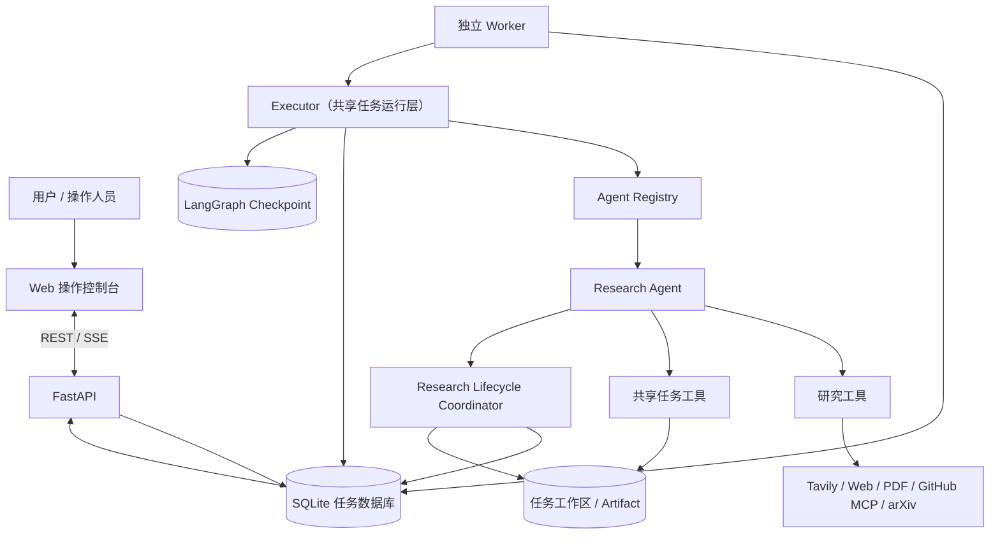
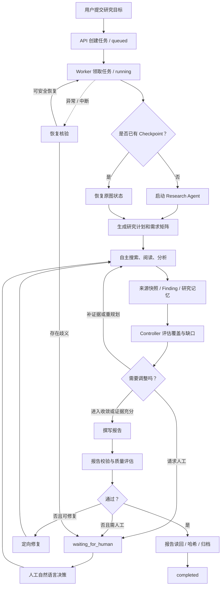

# 长时运行的研究数字员工

基于 **Deep Agents、LangGraph、FastAPI 和 SQLite** 构建的长时自主研究系统。用户提交研究目标，Research Agent 自主制定和调整研究计划，调用外部工具检索与阅读资料，登记来源和研究发现，保存中间成果，并生成有证据依据的 Markdown 报告。独立 Worker 在后台执行任务，因此关闭浏览器不会中断正在运行的研究。

本项目面向开发测试题中的核心场景，例如调研当前主流 Coding Agent 的技术架构，比较任务规划、工具使用和上下文管理，并形成有依据的 Markdown 报告。研究任务可能持续几十分钟甚至更久，执行过程中可能获得新信息、遇到外部服务故障或进程中断；系统需要继续推进任务，并让开发者能够理解、诊断和复盘执行过程。

## 项目特点

| 测试题要求 | 当前实现 |
|---|---|
| 自主研究与动态规划 | Agent 根据任务目标和研究证据，自主选择搜索、阅读、分析和后续行动；通过结构化计划记录战略变化 |
| 调用搜索、读取资料、保存中间成果 | Tavily、网页/PDF、GitHub MCP、arXiv；任务级 Artifact、研究记忆、来源快照和 Finding 登记簿 |
| 支持长时间运行和真实故障 | 独立 Worker、SQLite 任务状态、LangGraph Checkpoint、租约/心跳、重试、预算闸门和保守恢复 |
| 理解执行过程并分析问题 | 持久化事件账本、模型/工具调用记录、SSE 回放、计划快照、证据、预算、质量评估和恢复记录 |
| 区分岗位能力与共享基础能力 | Agent Registry 定义岗位契约；Worker、Executor、任务状态、持久化、预算和审计由共享任务运行层统一提供 |
| 技术选型开放 | 使用 Python、Deep Agents、LangGraph、FastAPI、SQLite 和 OpenAI 兼容模型接口，相关组件可按岗位和部署需要替换 |
| 界面定位与工程重点 | Web 控制台提供任务操作、执行观察和人工决策入口；工程重点是 Agent 自主性、持久化、证据控制、恢复和测试验证 |

项目以任务生命周期为组织主线，将自主研究、持久化状态、证据约束、资源边界、质量门禁和异常恢复整合为统一执行系统。

## 架构概览



### 核心模块

| 模块 | 职责 |
|---|---|
| FastAPI 操作接口 | 创建和控制任务，查询岗位、事件、计划、研究状态、证据、预算和成果，处理人工决策 |
| Agent Registry | 描述岗位 Builder、Profile、产物路径、校验器、修复器、Finalizer 和默认预算 |
| Research Agent | 自主规划、选择工具、研究资料、分析证据、保存记忆并撰写报告 |
| 共享任务工具 | 任务级文件读写、长期记忆、预算查询和预算扩展申请 |
| 研究工具 | 网络搜索、网页/PDF、GitHub 仓库与源码、arXiv 论文 |
| Research Controller | 根据研究维度、Finding 和有效来源计算覆盖率，识别关键缺口与停滞并提出下一步建议 |
| Research Evaluator / ReportValidator | 校验报告结构和引用关系，结合规则评分与独立上下文评审执行质量门禁 |
| Worker / 共享任务运行层 | 任务领取、租约、心跳、Checkpoint、预算、错误分类、重试、恢复和终态处理 |
| 持久化与审计 | SQLite 任务与事件、LangGraph Checkpoint、任务工作区、工具调用台账和恢复记录 |

### 三类持久化数据

- `data/tasks.sqlite`：任务状态、Worker 所有权和执行代次、预算、事件、工具调用、研究控制、质量评估、恢复决策和人工干预。
- `data/checkpoints.sqlite`：LangGraph 图状态和消息历史，以 `task_id` 作为 `thread_id`。
- `workspaces/{task_id}/`：研究计划及版本历史、研究记忆、来源快照、Evidence Registry、中间成果和最终报告。

三者职责不同：任务数据库记录业务事实，Checkpoint 保存 Agent 执行上下文，工作区保存研究资料和交付物。恢复时先核验工具副作用和 Checkpoint，再决定是否继续执行。

## 研究执行闭环

1. **接收任务**：API 校验岗位并创建持久化任务，按岗位配置设置默认预算。
2. **后台领取**：Worker 获取全局租约，领取任务并递增 `worker_generation`；浏览器提供任务操作与执行观察界面，Worker 持续执行研究任务。
3. **规划研究**：Agent 生成 3–8 个步骤的整体研究计划，并定义 3–12 个研究维度组成覆盖矩阵。
4. **自主研究**：Agent 根据证据自主选择搜索、网页/PDF 阅读、GitHub 或 arXiv 检索；资料读取后登记来源快照，重要结论形成关联来源和研究维度的 Finding。
5. **动态调整**：Research Controller 计算维度覆盖率、关键缺口和停滞情况，给出补充证据、重规划、继续、收敛或请求人工等建议。Agent 根据实际证据决定具体研究动作。
6. **综合交付**：Agent 撰写 `report.md`；ReportValidator 检查结构、来源 ID、URL 和段落引用；ResearchEvaluator 执行五维质量评估。
7. **修复与收敛**：质量缺陷以结构化反馈交给 Agent，最多进行三轮交付修复；遇到评审不可用、持续质量问题或恢复歧义时进入人工待办。
8. **持久化完成**：报告读回核验并记录哈希，岗位 Finalizer 归档计划和执行结果。



## 工具与证据

| 工具 | 用途 |
|---|---|
| `web_search` | 使用 Tavily 搜索公开网页 |
| `fetch_url` | 读取公开网页正文并保存来源快照 |
| `fetch_pdf` | 下载公开 PDF，按页提取文本并登记证据 |
| `github_repo` / `github_tree` / `github_read` / `github_releases` | 只读查看 GitHub 仓库、目录、源码和 Release |
| `arxiv_search` / `arxiv_paper` | 使用官方 Atom API 检索并读取论文 |
| `save_artifact` / `read_artifact` / `list_artifacts` | 保存、分段读取和列出任务中间成果 |
| `save_research_memory` / `read_research_memory` | 保存和恢复跨上下文压缩、跨进程运行的研究记忆 |
| `define_research_requirements` / `get_research_status` | 定义研究覆盖矩阵并查看证据覆盖状态 |
| `record_finding` / `get_evidence_registry` | 登记证据关联结论并查询来源与 Finding |
| `update_research_plan` / `update_plan_step_status` / `set_active_plan_step` | 管理战略计划、步骤进度和工具调用关联 |

来源快照具有稳定的来源 ID（如 `[S0001]`）和内容哈希。Finding 记录结论、来源 ID 和研究维度。报告中的关键事实通过 `[Sxxxx]` 引用，Sources 章节提供直接 URL，形成从报告到来源快照的追溯链。

GitHub 集成默认使用官方托管只读 MCP 端点，读取文件前先建立目录索引，并固定到索引对应的 Commit SHA。arXiv 使用官方 Atom API。GitHub 访问为可选能力；没有 PAT 时，其他研究工具仍可使用。

## 长任务可靠性

- **任务状态与执行代次**：SQLite 保存任务状态、Worker 所有权和 `worker_generation`；每次领取都会校验所有权，避免旧 Worker 在接管后继续写入。
- **Worker 租约与心跳**：全局租约保证当前单机版本同一时刻只有一个 Worker 执行；心跳用于识别失联 Worker。
- **断点恢复**：LangGraph SQLite Checkpoint 保留图状态；任务重试复用原 `task_id`、Checkpoint 和工作区。
- **工具调用核验**：工具调用开始、成功、失败和未知状态均持久化。只读请求允许按预算重试；已知写操作先通过 Artifact、Finding、计划或进度记录核验；无法确认的副作用转人工处理。
- **错误分类与重试**：区分可重试和终态错误，按有上限的指数退避重试；人工也可对失败任务发起重试。
- **预算和收敛**：工具调用、累计运行时间和 Token 均受硬预算约束；预留部分资源用于报告综合、保存、验证和修复。
- **人工协同**：人工指令以自然语言输入，保留原始意图和审计记录；Agent 负责将其转化为完整研究要求或计划变化。

## 资源预算

研究岗位默认值：

| 资源 | 默认上限 |
|---|---:|
| 工具调用次数（`max_steps`） | 30 |
| 累计运行时间 | 3,600 秒 |
| Token | 100,000 |

主 Agent 模型调用前预留启发式输入 Token 估算、4,096 Token 输出额度和 256 Token 固定开销；可用时优先按 Provider 返回的 usage 结算。收敛阶段默认保护 Token 预算的 30%、工具调用次数的 25% 和运行时间的 20%，并受最小值和最多预留一半的规则约束。暂停期间不计入累计运行时间。

预算扩展必须经操作人员批准。因硬预算闸门失败的任务可在扩额后复用已有 Checkpoint 和工作区继续执行。

## 本地运行

### 环境要求

- Python 3.12（`pyproject.toml` 支持 Python 3.12–3.13）。
- OpenAI 或 OpenAI 兼容的 Chat Completions 模型接口。
- Tavily API Key（网络搜索需要）。
- GitHub Fine-grained PAT（可选，只读仓库访问）。
- Node.js 22（仅用于测试前端 JavaScript；运行后端不需要 Node）。

### 安装

Windows PowerShell：

```powershell
py -3.12 -m venv .venv
.\.venv\Scripts\Activate.ps1
python -m pip install --upgrade pip
pip install -r requirements.txt
Copy-Item .env.example .env
```

macOS / Linux：

```bash
python3.12 -m venv .venv
source .venv/bin/activate
python -m pip install --upgrade pip
pip install -r requirements.txt
cp .env.example .env
```

在项目根目录 `.env` 中设置：

```dotenv
OPENAI_API_KEY=your_api_key
OPENAI_MODEL=your_model_name
# 使用兼容模型服务时填写
OPENAI_BASE_URL=https://your-compatible-endpoint/v1

TAVILY_API_KEY=your_tavily_key

# 可选：启用 GitHub 只读工具
GITHUB_PERSONAL_ACCESS_TOKEN=
GITHUB_MCP_TRANSPORT=remote
GITHUB_MCP_REMOTE_URL=https://api.githubcopilot.com/mcp/readonly
```

模型超时、上下文窗口、Worker 心跳和租约、重试策略、网页下载大小及 GitHub MCP 连接参数均可通过 `.env.example` 中的配置项调整。不要将真实密钥提交到 Git。

### 启动

终端 1：启动 API 和 Web 控制台。

```bash
uvicorn app.api.main:app --reload --host 127.0.0.1 --port 8000
```

终端 2：启动独立 Worker。

```bash
python -m app.runtime.worker
```

访问 <http://127.0.0.1:8000/> 创建和观察研究任务。API 与 Worker 分离运行；浏览器关闭不会停止后台任务。

## 主要 API

| 方法 | 路径 | 作用 |
|---|---|---|
| `POST` | `/tasks` | 创建任务 |
| `GET` | `/tasks`、`GET /tasks/{task_id}` | 查询任务 |
| `GET` | `/agents` | 查询已注册岗位 |
| `GET` | `/tasks/{task_id}/events` | 查询事件 |
| `GET` | `/tasks/{task_id}/events/stream` | SSE 实时事件流 |
| `GET` | `/tasks/{task_id}/plan` | 当前计划、版本历史和步骤进度 |
| `GET` | `/tasks/{task_id}/research` | 研究控制、质量评估、恢复和人工决策状态 |
| `GET` | `/tasks/{task_id}/evidence` | 来源和 Finding 登记簿 |
| `GET` | `/tasks/{task_id}/memory` | 持久化研究记忆 |
| `GET` | `/tasks/{task_id}/budget` | 预算使用情况 |
| `GET` | `/tasks/{task_id}/artifacts` | 任务成果列表 |
| `POST` | `/tasks/{task_id}/pause`、`resume`、`retry`、`cancel` | 任务控制 |
| `POST` | `/tasks/{task_id}/budget/approve` | 批准预算扩展 |
| `POST` | `/tasks/{task_id}/human-intervention/resolve` | 提交人工决策 |
| `DELETE` | `/tasks/{task_id}` | 删除任务及关联数据 |
| `GET` | `/health`、`/system/overview` | 服务健康和运行概览 |

SSE 事件先写入数据库，再推送给前端；支持 `Last-Event-ID` / `after_id`，可从事件游标继续回放。

## 测试与验证

本地执行：

```bash
python -m pytest -v
node --check app/static/app.js
```

GitHub Actions 在 Ubuntu 和 Windows、Python 3.12 环境运行 pytest，并使用 Node.js 22 检查前端 JavaScript。自动化测试使用本地 SQLite 和测试替身，不调用真实模型 API，也不产生真实 Token 费用。

重点验证：

- `tests/test_autonomous_research_e2e.py`：根据实际工具证据决定是否重规划，并验证质量反馈驱动的报告修复。
- `tests/test_process_crash_recovery.py`：通过真实子进程中断验证 Artifact、工具调用和 Checkpoint 的恢复。
- `tests/test_worker_fencing_races.py`：验证 Worker 接管、执行代次隔离和并发终态写入。
- `tests/test_recovery_consistency.py`：验证跨存储状态和工具副作用核验。
- `tests/test_role_extensibility.py`：验证第二岗位在测试环境中复用共享任务运行层。
- `tests/test_documentation.py`：检查文档编码、路径引用和关键设计实现。

控制台附带一个[只读任务执行样例](examples/rainbow-research/README.md)，展示脱敏的真实报告、执行事件、研究计划、证据、预算和人工决策。样例以静态快照方式呈现，与可运行任务数据库分离，查看时无需调用模型。该历史任务的独立质量评审状态为 `unavailable`，质量评估结果为 `passed=false`，最终经人工批准降级交付；样例保留了相应的执行轨迹与人工决策记录。

## 设计文档

- [设计说明：数字员工的定义、模块划分、三个技术问题和半年后的改进方向](DESIGN.md)
- [系统架构与关键技术取舍](DESIGN_OVERVIEW.md)
- [研究生命周期、证据控制、质量评估与恢复机制](DESIGN_TRUSTED_RESEARCH_LIFECYCLE.md)

## 当前运行范围

当前版本是用于验证核心设计的单机 MVP：生产环境默认注册 `research` 岗位，并通过全局租约运行一个 Worker。Agent Registry 已将岗位构建、配置、产物、校验、修复、收尾和预算抽象为注册契约；第二岗位目前在测试中验证公共运行时复用。后续可在不改变岗位职责边界的前提下扩展队列、Worker 池和多岗位调度。
